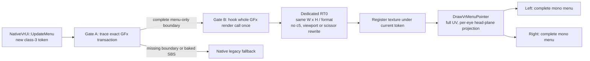

# Class-3 pause menu: minimal capture design for MAIN

**Audience:** MAIN on `fix/pause-menu-modes` (`96390ab`).

**Decision:** do not merge another viewport/scissor/c5/SBS mode as a fix. The
only correctness-preserving implementation is to redirect the **entire native
class-3 GFx render transaction** to one dedicated target of the same logical
size, then present that target through the existing head-plane provider. The
required GFx transaction boundary has not yet been observed, so the next
production change must be a bounded *observation* patch, not the redirect.

## What is and is not known

The evidence in `58e9c65:docs/audits/pause-menu-head-overlay.md` proves that
class 3 (`RvUIGFxMovie_Pause`) has no observed private `1280x720` movie target.
Known GFx-looking fragments draw on scene HDR `5264x2684`: MDG 137
(`DrawIndexedPrimUP`, stride 12, 42 primitives) and MDG 263 (stride 8, 10
primitives). Their matrix offsets differ, and the same generation contains many
`kind=1` indexed draws. No trace maps any group to a regular option,
Objectives, highlight, panel, or cursor.

`PauseMenuDiag` records class-3 `compose=0` on the scene path and submit state
`dup=1 stereo=0 menuFlat=0 cropEyes=0`. It does not identify the draw containing
Objectives; its four-column luma sample cannot prove text placement.

Therefore it is not honest to list every contributing batch yet. The exact
missing observation is an **ordered complete class-3 render transaction with a
native state delta**: root menu, changed regular selection, then Objectives.
Every draw needs its RT0 surface/epoch and caller boundary. A batch belongs to
the movie only if it is inside that boundary and changes with one of those
states.

## Review of MAIN's modes

`96390ab:spikes/view_matrix/pause_menu_mode.h` has four sources:

| Mode | Current source/presentation | Decision |
|---|---|---|
| `Legacy` | Native scene, submitted as SBS half rectangles | Safe fallback; retains the split. |
| `HeadGfx` | Selected class-3 ortho batches → `1280x720` pool → provider | Reject: fragments only; earlier headset result left the list on the monitor. |
| `FullGfxMono` | Scene colour `StretchRect` → pool → provider | Reject: captures world + monitor + UI, changing scale/timing. |
| `FullSource` | Full backbuffer stretch and blit to both halves | Reject: flattened full scene; it cannot reconstruct a menu. |

Mode 1 enters in `HudStereoPair` (`d3d9.cpp` ~17588; class-3 branch ~17836),
which is necessarily per-draw and too late. Mode 2 uses
`PauseMenuMode2NoteSource` / `PauseMenuMode2Capture`; mode 3 calls
`PauseMenuMode3Bake` before `CopyBackbufferToD3D11` (`d3d9.cpp` ~10995). None
has a menu-only source or coordinate guarantee.

## Coordinate-space rule

Do not assume Objectives is already SBS encoded. Preserve the complete original
composition space instead: render the whole native class-3 transaction to a
target with the original RT0 `width`, `height`, and colour format. The provider
samples full UV `[0,1]²` once per eye. This preserves a single 2D canvas without
crop/stretch. If the transaction itself proves to bake SBS columns, abort the
redirect; no reconstruction heuristic is allowed.

## Preferred implementation: complete transaction redirect

This is preferred over a late-frame capture because it preserves GFx draw order,
glyph atlases, blend states, logical coordinates, and native input. It creates
one target, invokes GFx once, and draws two provider quads. It does not duplicate
individual draws, alter c5, or change eye submission.

Start with the original descriptor, not `1280x720`. At measured `5264x2684`,
A8R8G8B8 is about 53.9 MiB; A16B16G16R16F is about 107.8 MiB. A smaller target
is allowed only after a measurement proves it preserves GFx layout, clipping and
text rasterisation.

### Exact seams and minimal code changes

1. **Token lifetime — existing:** `NativeVrUi::UpdateMenu`
   (`native_ui_input.h` lines 39–55) publishes `g_vrMenuStateToken` and
   `g_vrMenuClass`. Reset a `PauseMovieCapture` record only when class 3 gains a
   new token.
2. **RT discovery — existing:** `Hook_SetRenderTarget`
   (`d3d9.cpp` ~11793) already increments `g_vrUiTargetEpoch`, has RT0's
   descriptor, and identifies the backbuffer. Gate A adds a bounded log here;
   it must not change the target or `g_rtIsScene`.
3. **Draw discovery — existing:** all four primitive hooks call
   `MenuDrawTraceRecord` (`menu_draw_trace.h`). Add target epoch, per-token
   ordinal and caller return address. Decode bounds only for proven vertex
   layouts; never treat arbitrary indexed bytes as XY coordinates.
4. **New required hook:** resolve the whole render call of the live
   `RvUIGFxMovie_Pause` (or the equivalent GFx renderer entry) before its first
   class-3 draw and after its last. That address/vtable slot is currently
   unknown. The input poll hook is not it; recover it from Gate-A call stacks.
5. **Gate-B detour:** save complete D3D9 state, bind a same-descriptor dedicated
   RT0, preserve original viewport/scissor values, invoke the original whole
   render exactly once, then restore. Do not special-case draws or rewrite c5.
6. **Provider — existing:** on success, register the dedicated texture using
   `CaptureVrMenuTarget` / `SyncVrMenuCaptureState`
   (`vr_menu_overlay.h` ~470/~487). Add it to `g_vrMenuSources`; existing
   `Hook_SetTexture` and `SuppressCapturedVrMenuDraw` then suppress only the
   monitor sampling that exact texture.
7. **Presentation — existing:** retain `DrawVrMenuPointer` (~544), adding only
   `capture.complete && token == VrMenuStateToken()` for class 3. Its full-UV
   per-eye projection and `NativeVrUi::Coordinates` input mapping stay intact.
8. **Fail closed:** unresolved hook, allocation/bind/render failure, unknown
   group, token change or stale texture invokes the native render path and does
   not enable provider suppression.

### Lifetime/state contract

Create after the original descriptor is known (`D3DPOOL_DEFAULT`,
`D3DUSAGE_RENDERTARGET`, original format); recreate on descriptor/reset and
release from `ReleaseVrMenuResources` plus device-reset handling. Save/restore
RT0, depth stencil, viewport, scissor + enable, shaders/declaration/streams,
indexes, GFx textures, blend/depth/raster states and relevant constants. Clear
once per whole transaction, not per fragment.

## Alternative: capture after composition

The currently available late boundary is the full source consumed by
`CopyBackbufferToD3D11` / `UpdateFromHeadset`. It contains world, monitor,
effects and UI. MAIN's mode 3 already shows why this is not menu capture:
head-plane use flattens the scene; writing it to both halves repeats full-SBS
duplication. This alternative becomes viable only if Gate A finds a **menu-only
completed RT** after the last GFx batch and before monitor sampling. Current
evidence does not show one, so reject it for now.

## Gate A: required runtime observation

Implement `PauseComposeTrace=1`, bounded to one class-3 token and two stable
frames in each state below. No draw-time allocation/readback/file I/O; stop with
an explicit `TRUNCATED` record on capacity overflow.

### Record

For each RT0 bind/draw: token, epoch, ordinal, thread, return address (or a
safe short call-stack hash), RT0 descriptor, viewport, scissor, clear, draw API,
shader/decl/VB/IB identity, stages 0–3 textures, blend/depth state, and c5 only
as metadata. Include bounded output-region evidence from known vertex layouts
or a GPU query.

### Script

1. Pause: root menu, two stable frames.
2. Move one normal selection, two stable frames.
3. Open **Objectives**, two stable frames.
4. Change/scroll one objective if possible, two stable frames.
5. Back out and close.

The trace must classify changed groups as persistent panel, regular rows,
selection, Objectives, cursor, or `unknown`. Any pause-visible `unknown` group
blocks Gate B.

### Gate-A acceptance

- No trace truncation and an RT0/draw ledger for all five states.
- One caller boundary includes every state-delta group and excludes world draws.
- A saved full target proves normal text and Objectives share one `[0,W)×[0,H)`
  image, not opposite eye rectangles.
- The target's normalized UVs map to `NativeVrUi::Coordinates`; a regular row
  and an Objectives row both trigger their native actions.

## Gate B validation

| Check | Proof required |
|---|---|
| Transaction helper tests | Clear once/token; nested calls do not clear; error/stale token falls back native. |
| Coverage ledger | Background, normal rows, selected row, Objectives, cursor all present; `unknown=0`, `dropped=0`. |
| Mono source | Full UV canvas contains both normal text and Objectives, with no SBS-half assumption. |
| Both eyes | Two provider draws use the same complete texture/full UV; class 3 has no crop/bake counter. |
| Interaction | Ray UV → `NativeVrUi::Coordinates` → native click succeeds for a normal and Objectives row. |
| Regression | Classes 1/2/4, Bink, HUD and class-3 fallback have zero class-3 redirect/suppression events. |

For PSVR2 acceptance, collect separate eye images in root and Objectives states:
both images must show the whole page. A successful allocation/counter without
both labels is a failure.

## Why this avoids the earlier failures

It never remaps c5, halves viewport/scissor, copies an SBS half, expands a
draw-shape heuristic, or captures the late full scene. Exact GFx transaction
ownership makes the source complete before the existing provider presents it.

## MAIN handoff

Implement **Gate A only** first. If no whole-GFx caller boundary or menu-only
completed RT is found, stop: the existing D3D draw hooks cannot safely rebuild
this menu. If Gate A passes, implement the single whole-transaction redirect;
modes 1–3 must remain experimental diagnostics, not claimed fixes.
