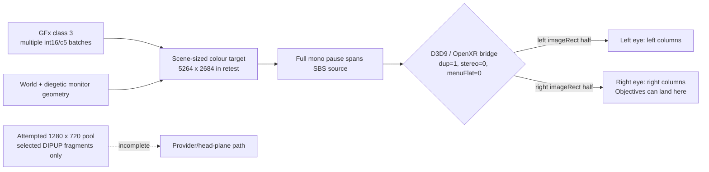

# Pause-menu stereo: independent root-cause report

**Status:** `BROKEN` / evidence-backed diagnosis; no renderer change in this
branch.  This report supersedes the unsafe inference that pause class 3 has the
same private `1280x720` GFx texture as main-menu class 2.

## Finding

The in-game pause movie (**GFx class 3**) is not a single, capturable `1280x720`
movie texture.  It is composed as several GFx batches directly into the
scene-sized colour path (`5264x2684` in the physical retest).  By the time the
OpenXR bridge sees it, the *complete mono pause layout* occupies the full
side-by-side source.  Class-3 submission is `dup=1, stereo=0, menuFlat=0`, so
the bridge gives the left half of that layout to one eye and the right half to
the other.  That is why “Objectives” and the ordinary rows can be visible in
different eyes.

This is a source-layout problem before the OpenXR eye rectangles, not a global
`c5`, viewport, or scissor defect.

## Evidence and exact references

The references below name immutable Git revisions because this research branch
intentionally predates MAIN's in-progress mode work.

| Evidence | What it establishes |
|---|---|
| [`58e9c65` `docs/audits/pause-menu-head-overlay.md`](../../docs/audits/pause-menu-head-overlay.md) (the frozen-experiment revision) | Physical retest: class 2 has an engine-private `1280x720` target; class 3 has no such row and its flash batches land on scene HDR `5264x2684`. The identified DIPUP batches are fragments, not a menu identity. |
| `300a956:spikes/view_matrix/d3d9.cpp`, `HudStereoPair` (~17532), `PauseCanvasNeedsEyeCopy` (~18171) | Class-3 canvas batches enter the HUD path. The older c5 fix only reaches a subset of user-pointer draws and cannot make the whole movie atomic. |
| `300a956:spikes/view_matrix/d3d9.cpp`, `PauseMenuDiagNoteCompose` (~129), `PauseMenuDiagNoteSubmit` (~132), and the call sites (~17532, ~10951) | The purpose-built diagnostic records `compose=0` for the scene/offscreen stage and `dup=1 stereo=0 menuFlat=0 cropEyes=0` at submit. Its log text explicitly says each eye keeps one SBS half. |
| `2300161:spikes/view_matrix/menu_submit_policy.h`, `MenuSubmitForcesFlat` | The corrected submission policy makes only class 1 flat; classes 2–4 retain the scene. This removed a separate class-3 right-eye discard, but cannot repair a class-3 layout that is already one mono canvas across the full source. |
| `1c370f8` / `58e9c65`, `pause-menu-head-overlay.md` | The pooled target only redirects stride-8/12 `DrawIndexedPrimUP` flash fragments. Many class-3 indexed draws remain outside it. A later headset result left the list on the diegetic monitor; the experiment is explicitly frozen. |

The older GFx c5 diagnosis remains useful but narrower than the reported
symptom: for each batch, `c5..c8` maps its int16 GFx vertices to clip space
(`clipX = vx*c[0] + c[12]`, `clipY = vy*c[5] + c[13]`).  It is **not** an
ownership token for the entire pause movie.  Thus c5 rewrites, viewport halves,
and scissor halves can move or clip an individual batch while leaving other
class-3 batches in their original source space.

## Where the complete menu exists

The complete class-3 menu is known to exist only as the **full-width composed
scene/backbuffer image immediately before the D3D9-to-OpenXR copy**, after the
diegetic monitor/GFx batches have been rendered.  There is no evidence of an
isolated pre-split class-3 `1280x720` source analogous to main-menu class 2.

Capturing that full scene target is not a UI solution: it also captures the
world and would turn a head-relative mono menu into a stale scene screenshot.
The missing seam is an engine-level class-3 composition boundary (or a precise
replacement for it), not a different output size.

## Why the attempted fixes did not change the result

1. **c5 / viewport / scissor remaps:** they operate per draw.  Class 3 is a
   multi-batch GFx composition, so altering one observed canvas or font batch
   cannot make a complete texture for both eyes.  The original backbuffer-only
   c5 route also missed the scene-sized compose path documented by
   `PauseMenuDiag`.
2. **`menuFlat`:** for class 3, the old implementation copied *one already
   incomplete SBS half* to both eyes.  It made both eyes identical but did not
   recover the other half.  The current class-1-only policy correctly avoids
   that loss; it does not by itself create a mono pause surface.
3. **Pooled `1280x720` capture:** the size is not the issue.  The pool received
   only conservative stride-8/12 DIPUP fragments, while the trace contains
   additional indexed/scene batches.  It therefore cannot replace the native
   list.  A successful pool allocation, captured counter, or provider draw is
   not proof that the list was captured.
4. **Diegetic-monitor reasoning:** it correctly explains the main-menu path,
   but it was over-generalized.  Class 2 is an identifiable private movie
   texture; class 3 is presently observed on the scene path.  Treating both as
   the same target produced the false `1280x720` premise.

## Best existing presentation path

Use the existing **captured-menu provider path** (`CaptureVrMenuTarget` →
`DrawVrMenuPointer` / head-plane per-eye projection) *only after* it is fed a
complete class-3 movie surface.  It already has the desirable properties:

- draws the same texture once per eye with `VrUiProjectEye`, rather than
  splitting one source canvas by SBS rectangles;
- shares the established native GFx input/laser mapping; and
- does not require `VrXrSubmitMenuFlat` to discard an eye.

The native class-3 diegetic path should remain the safe fallback.  Do **not**
use the generic full-scene capture, `menuFlat` crop, or another expanded
draw-signature classifier as the presentation source.

## Are MAIN's runtime modes actually distinct?

They are distinct only when their **source contract** is explicit:

| Mode | Source contract | Feasible now? | Meaningful result |
|---|---|---:|---|
| Native diegetic | Scene owns class-3 batches; OpenXR gets SBS halves | Yes | Current fallback; currently broken for full mono layout. |
| SBS crop-flat | A selected half already contains the entire flat menu | No for class 3 | Invalid: duplicates one partial half. |
| Provider/head-plane | A private texture contains all class-3 pixels for the current generation | Not yet | Correct intended mono menu in both eyes. |
| Fragment pool | Selected DIPUP batches happen to equal the whole movie | Falsified by current trace | Not a valid mode; debug experiment only. |

Accordingly, a runtime switch can be technically useful for A/B observation,
but modes 2 and 4 must not be described as independent complete-menu fixes.
They only become genuine alternatives after a complete class-3 composition
source is demonstrated.

## Recommended minimal correction

1. Keep `MenuSubmitForcesFlat(3) == false`; do not reintroduce a class-3 SBS
   crop as a “flat” fix.
2. Remove/disable the class-3 pooled-fragment path from any default or
   acceptance claim.  Preserve it only as an explicitly labelled diagnostic if
   MAIN needs its counters.
3. Add no further c5, viewport, or scissor experiments.  First instrument a
   single **composition transaction**: correlate class-3 focus generation,
   all RT0 changes/draws, and the final texture sampled by the diegetic monitor.
4. Once a complete private class-3 surface is proven, route that surface through
   the existing provider/head-plane path.  Until then, retain native diegetic
   rendering as the fallback.

## Runtime evidence MAIN must collect

Collect one bounded record per class-3 open/close generation, not per draw:

- `PauseMenuDiag=1`: the `pause-evidence compose` and `pause-evidence submit`
  lines, including target dimensions, `compose`, `dup`, `stereo`, `menuFlat`,
  and `cropEyes`.
- A four-column pixel sample or lossless SBS capture of the exact source copied
  to OpenXR.  Mark the horizontal spans of “Objectives” and one normal row; it
  must prove whether they occupy different source halves before submission.
- RT0 lifecycle for the class-3 generation: `SetRenderTarget`, viewport,
  scissor, clear, texture/sampler stage, and frame number.  Identify whether
  any non-scene private target receives **all** class-3 batches.
- Per-candidate coverage: total class-3 draws/batches, redirected draws,
  suppressed native draws, and provider draws.  A valid provider candidate
  requires coverage of the whole menu (background, rows, Objectives, highlight,
  cursor), not merely `pauseMenuProvided > 0`.
- A left/right capture with native path, `menuFlat` crop, and provider path.
  For the valid provider source, both eyes must show all text; for the native
  path, the capture should reproduce the split and hence validate the model.
- Input evidence: pointer UV / ray hit against the provider's full canvas,
  plus one select/back action.  A complete presentation that breaks the
  current-generation GFx input is not an acceptable replacement.

## Non-recommendations

- Do not broaden a DIPUP, shader, stride, c5, or “looks like GFx” signature
  until the complete source is independently proven.
- Do not capture the scene-sized render target as a menu texture.
- Do not treat successful D3D allocation, a pool counter, or a single overlay
  row as visual validation of the native pause movie.
