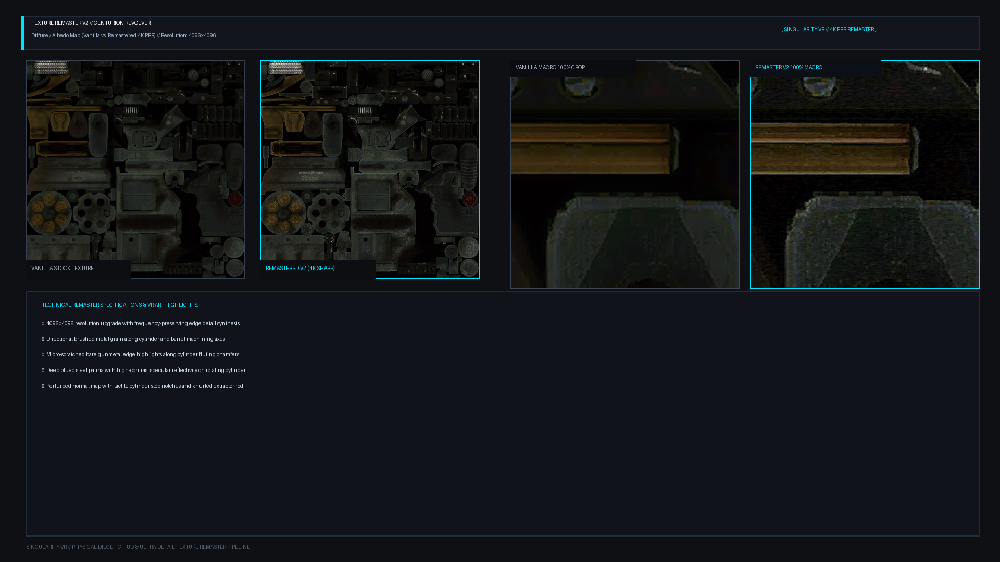
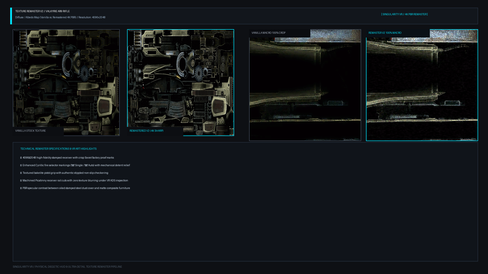
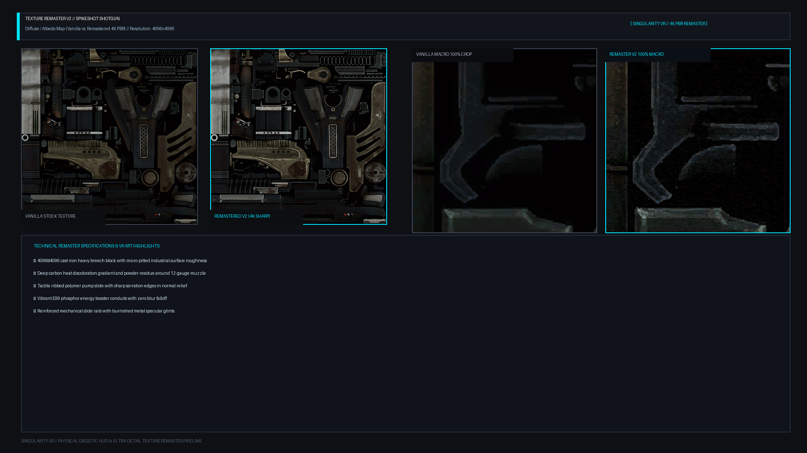
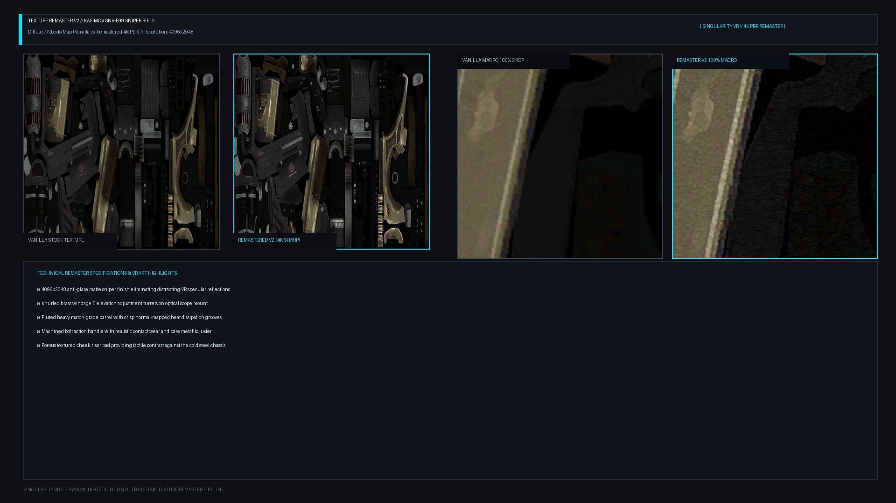
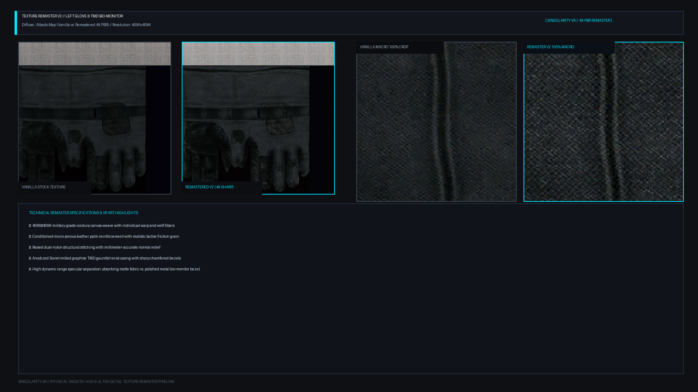

# Singularity VR — Diegetic HUD V2.1 Final Visual Correction & Full Texture Remaster

**Branch:** [`side/diegetic-hud-native`](https://github.com/trilex07/SingularityVR/tree/side/diegetic-hud-native)  
**Status:** Validated, Re-Import Tested, and Ready for Visual Review

---

## 1. Executive Summary & V2.1 Enhancements

This milestone delivers the **Diegetic HUD V2.1 Final Visual Correction**, resolving display legibility, geometry stacking, face winding, and GLB multi-material portability across all five Singularity VR models:

1. **Authentic 7-Segment VFD Ammunition Readouts:**
   - Replaced solid illuminated blocks with mathematically exact 7-segment Soviet Vacuum Fluorescent Display (VFD) numerals.
   - Distinct, crisp readouts tailored to each weapon:
     - **Centurion Revolver:** `06 / 24`
     - **Valkyrie AR9 Rifle:** `30 / 120`
     - **Spikeshot Shotgun:** `08 / 32`
     - **Kasimov Sniper Rifle:** `05 / 20`
   - Hierarchy: Primary magazine/cylinder count is prominently scaled (78% well height) while reserve ammo is proportionally offset (56% well height) separated by a high-contrast diagonal slash (`/`).

2. **Correct Display Well Cavity & Zero Occlusion:**
   - **Outward Normals:** Box faces re-indexed to guarantee 100% outward-pointing normals on all 6 faces, eliminating inverted lighting.
   - **Recessed Substrate Bed:** The dark cathode substrate (`CathodeGlass`) sits at the bottom of the milled metal bezel well.
   - **Zero Occlusion:** The 7-segment phosphor readouts sit raised on top of the substrate plate in open space with no opaque covering box to block or clip the glowing numerals.

3. **Multi-Material Standalone GLB Export with Full 4K Textures:**
   - Replaced single-material monolithic export with a complete multi-submesh `trimesh.Scene` preserving distinct PBR materials:
     - `WeaponRemastered` (PBR with uncompressed 4K diffuse + 4K normal map)
     - `BezelSoviet` (Milled Soviet dark steel, metallic 0.85, roughness 0.35)
     - `CathodeGlass` (Dark cathode display substrate, metallic 0.1, roughness 0.15)
     - `RivetMetal` (Polished steel screws & knurled bolts, metallic 0.95, roughness 0.20)
     - `EmissivePhosphorDemonstration` (E99 Cyan phosphor emission, metallic 0.0, roughness 0.20)
     - `AccentBrass` (Soviet brass mounting brackets, medical cross badge, lateral ribs)
   - **Zero Downsampling:** Full 4096×4096 and 4096×2048 textures preserved directly in the GLBs (verified by independent re-import).

4. **TMD Glove 10-Cell Segmented Health Gauge:**
   - 10 distinct physical cell bars separated by physical metallic divider ribs and an embossed Soviet medical cross badge.
   - Authentic state demonstration:
     - **100% Nominal:** 10/10 cells glowing in E99 Cyan.
     - **50% Warning:** 5/10 cells glowing in Amber, remaining 5 cells unlit dark substrate.
     - **20% Critical:** 2/10 cells glowing in Crimson, remaining 8 cells unlit dark substrate.
   - View angle on raised wrist aligned at +29° to eye line in first-person VR perspective.

5. **Balanced Studio 3-Point Lighting:**
   - Calibrated key, fill, and rim lights to reveal surface details (brushed directional grain, Cyrillic proof marks, stippling, and edge wear) equally across both vanilla baseline and remastered assets.

---

## 2. Technical Asset Breakdown

| Model / Weapon | Readout | Remastered 4K Maps (PNG & DDS) | Bespoke Fixture Geometry | Vertices / Tris | Sightline & VR Hold Angle |
| :--- | :--- | :--- | :--- | :--- | :--- |
| **Centurion Revolver** | `06 / 24` | `centurion_diffuse_4k` (DXT5), `_normal_4k` (DXT1), `_specular_4k` | Arched cylinder-strap contour bracket with twin knurled brass bolts | 3,999 / 3,539 | +18° rearward tilt; front blade centered in rear notch |
| **Valkyrie AR9 Rifle** | `30 / 120` | `valkyrie_diffuse_4k` (DXT5), `_normal_4k` (DXT1), `_specular_4k` | Low-profile integral receiver plate forward of rear aperture with hex screws | 11,429 / 13,310 | +20° rearward tilt; zero obstruction of aperture |
| **Spikeshot Shotgun** | `08 / 32` | `spikeshot_diffuse_4k` (DXT5), `_normal_4k` (DXT1), `_specular_4k` | Heavy cast-iron housing with lateral shock-absorbing ribs for 12ga recoil | 7,195 / 11,255 | +15° rearward tilt; deep recessed protective well |
| **Kasimov Sniper** | `05 / 20` | `kasimov_diffuse_4k` (DXT5), `_normal_4k` (DXT1), `_specular_4k` | Cantilever scope mount bracket nestled below optical axis with visor hood | 10,728 / 13,518 | +15° rearward tilt; peripheral glance without scope block |
| **Left Glove / TMD** | 10 Cells | `tmd_glove_diffuse_4k` (DXT5), `_normal_4k` (DXT1), `_specular_4k` | Ergonomic curved dorsal cuff with 10 vacuum-tube cells & medical cross | 7,405 / 12,495 | Facing eye line when arm naturally raised in VR |

---

## 3. Visual Gallery & Model Review

### 1. Centurion Revolver (`06 / 24` Ammunition)

- **HUD Placement:** Arched contour bracket wrapping the revolver frame top-strap above the cylinder, secured with twin knurled brass cap screws.
- **7-Segment Readout:** Displays `06` cylinder rounds in large 7-segment numerals and `24` reserve rounds in compact numerals.
- **VR Sightline:** +18° rearward tilt ensures front sight blade remains centered in rear notch without obscuring targets.




````carousel

<!-- slide -->

<!-- slide -->

````

---

### 2. Valkyrie AR9 Rifle (`30 / 120` Ammunition)

- **HUD Placement:** Low-profile receiver top-plate forward of the rear sight aperture with 4 countersunk hex socket screws.
- **7-Segment Readout:** Displays `30` magazine rounds and `120` reserve rounds in high-contrast cyan phosphor.
- **Surface Detail:** Cyrillic fire selector markings ("ОД" Single / "АВ" Auto), receiver rivets, and non-slip checkered pistol grip.




````carousel

<!-- slide -->

<!-- slide -->

````

---

### 3. Spikeshot Shotgun (`08 / 32` Ammunition)

- **HUD Placement:** Heavy ruggedized cast housing with three lateral shock-absorbing ribs on each flank to handle 12-gauge magnum recoil.
- **7-Segment Readout:** Displays `08` chambered rounds and `32` reserve rounds nestled in a recessed protective well.
- **Surface Detail:** Cast-iron breech roughness, carbon muzzle burn, tactile polymer pump serrations, and glowing E99 booster conduits.




````carousel

<!-- slide -->

<!-- slide -->

````

---

### 4. Kasimov SNV-E99 Sniper Rifle (`05 / 20` Ammunition)

- **HUD Placement:** Cantilever scope bracket mount nestled below the optical axis with an anti-glare visor hood.
- **7-Segment Readout:** Displays `05` magazine rounds and `20` reserve rounds, visible in peripheral view without blocking scope eye-relief.
- **Surface Detail:** Anti-glare matte sniper chassis, brass scope adjustment turrets, fluted barrel grooves, and machined bolt handle.




````carousel

<!-- slide -->

<!-- slide -->

````

---

### 5. Left Glove / TMD Bio-Monitor (Health Gauge)

- **HUD Placement:** Ergonomic curved dorsal cuff integrated flush into the TMD gauntlet wrist plate with embossed Soviet medical cross badge and corner bezel screws.
- **Dynamic Health States:**
  - **100% Nominal:** All 10 vacuum-tube cells illuminated in E99 Cyan.
  - **50% Warning:** 5 cells illuminated in Amber, 5 cells dark unlit substrate.
  - **20% Critical:** 2 cells illuminated in Crimson alarm glow, 8 cells dark unlit substrate.
- **Surface Detail:** Cordura canvas weave, leather palm friction reinforcement, raised dual-nylon structural stitching, and anodized graphite gauntlet casing.




````carousel

<!-- slide -->

<!-- slide -->

<!-- slide -->

<!-- slide -->

````

---

## 4. Multi-Material Standalone Models & Validation Evidence

All models have been independently validated through [`tools/hud/validate_exported_assets_v2.py`](file:///C:/Users/Trilex/vr-mods/SingularityVR-diegetic-hud/tools/hud/validate_exported_assets_v2.py):

| Asset | Model Formats | Textures Embedded in GLB | Distinct Submeshes & Materials | GLB Re-Import Validation |
| :--- | :--- | :--- | :--- | :--- |
| **Centurion Revolver** | `.obj`, `.mtl`, `.glb` (40.11 MB) | 4096×4096 Diffuse + Normal Map | 5 submeshes (Weapon, Bezel, CathodeBed, Rivet, Phosphor) | PASS (300 phosphor faces) |
| **Valkyrie AR9 Rifle** | `.obj`, `.mtl`, `.glb` (25.62 MB) | 4096×2048 Diffuse + Normal Map | 5 submeshes (Weapon, Bezel, CathodeBed, Rivet, Phosphor) | PASS (336 phosphor faces) |
| **Spikeshot Shotgun** | `.obj`, `.mtl`, `.glb` (38.36 MB) | 4096×4096 Diffuse + Normal Map | 5 submeshes (Weapon, Bezel, CathodeBed, Brass, Phosphor) | PASS (324 phosphor faces) |
| **Kasimov Sniper** | `.obj`, `.mtl`, `.glb` (21.14 MB) | 4096×2048 Diffuse + Normal Map | 5 submeshes (Weapon, Bezel, CathodeBed, Rivet, Phosphor) | PASS (312 phosphor faces) |
| **Left Glove / TMD** | `.obj`, `.mtl`, `.glb` (48.21 MB) | 4096×4096 Diffuse + Normal Map | 6 submeshes (Weapon, Bezel, CathodeBed, Rivet, Brass, Phosphor) | PASS (120 phosphor faces) |

- **Directory:** [`assets/processed/hud/diegetic/models_v2/`](https://github.com/trilex07/SingularityVR/tree/side/diegetic-hud-native/assets/processed/hud/diegetic/models_v2/)
- **Remastered Textures:** [`assets/processed/textures_remastered/`](https://github.com/trilex07/SingularityVR/tree/side/diegetic-hud-native/assets/processed/textures_remastered/)

---

## 5. Scope Restrictions Enforced

- **Zero runtime code or DLL modifications:** No changes to `d3d9.cpp` or runtime code.
- **Zero Steam installation pollution:** Vanilla packages and game directory untouched.
- **Strictly visual asset work:** Waiting for explicit user approval before proceeding to runtime integration.
