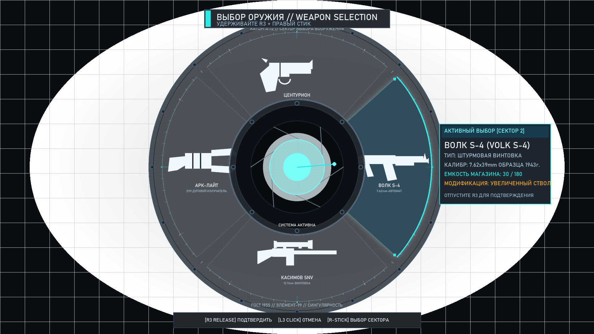
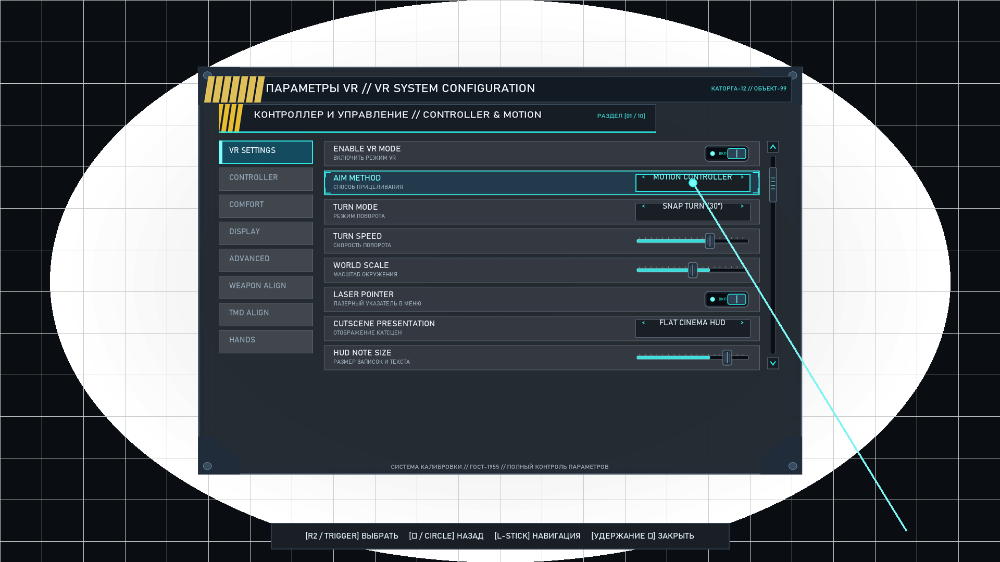
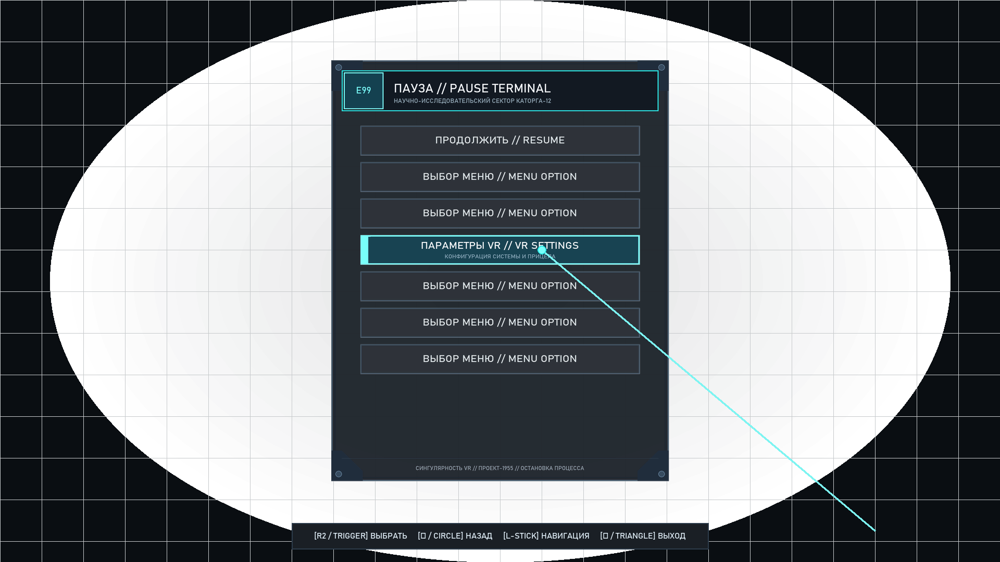
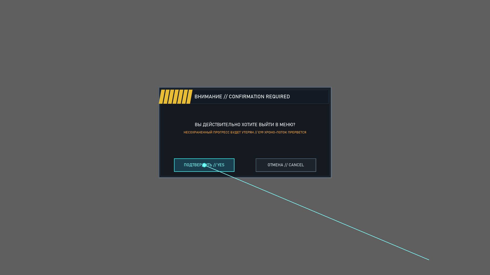
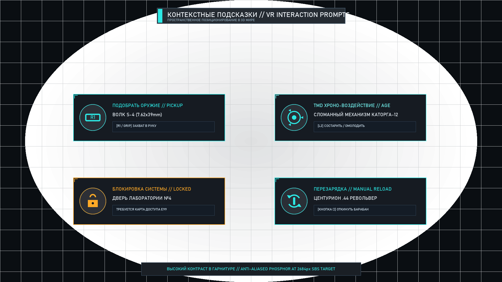
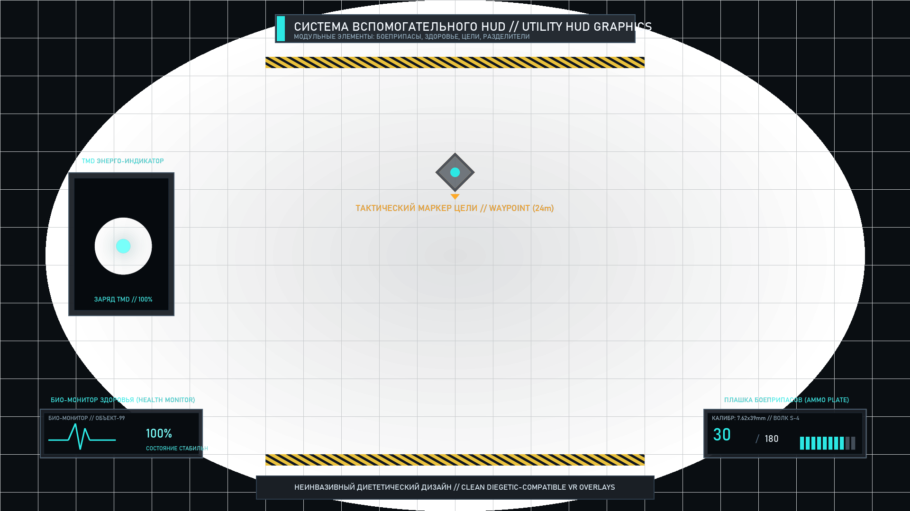

# Singularity VR — Visual Review: Interface & Utility Graphics Remaster

**Package:** Singularity VR UI & Utility Graphics Remaster  
**Role:** Senior Game UI / UX Artist and Technical UI Prototype Designer  
**Branch:** `side/ui-utility-graphics-remaster`  
**Status:** Visual Remaster Complete — Graphics & Prototype Deliverables Ready  

---

## Executive Summary & Design Rationale

Singularity (2010) features a distinctive visual identity centered on the isolated Soviet scientific facility of Katorga-12 and the reality-bending properties of Element 99. However, the game's original flat-screen UI and the initial VR mod's primitive debug overlays suffered from several critical VR readability issues:
1. **Low-resolution font rendering:** In the baseline VR mod, the in-game VR Settings menu used a hard-coded 5×7 bitmap font drawn via D3D `ClearRects` batches, which looked crude and could fail silently when page text exceeded rectangle bounds.
2. **Generic button prompts:** Controller prompt legends relied on generic low-resolution Kenney CC0 360-pad icon strips (`vr_prompt_atlas.bmp`), which lacked contrast against bright snow/fire scenes and failed to represent PSVR2 Sense controller inputs accurately.
3. **Flat monochrome weapon wheel:** The initial weapon wheel test rendered simple untextured cards (`W1`–`W4`), lacking tactile feedback and weapon silhouette recognition.
4. **Laser pointer minimalism:** The menu ray was a bare 1-pixel line with no contextual target expansion, click confirmation pulse, or hover feedback.

This remaster package delivers a comprehensive, production-oriented visual design system grounded in **dark Soviet retrofuturism, industrial brutalism, Cold War laboratory instrumentation, and E99 cathode luminescence**. Every asset has been authored with VR legibility constraints in mind—featuring heavy stroke weights, anti-aliased edge falloffs, high-contrast backing plates, and dedicated PSVR2 tactile glyphs.

> [!NOTE]
> This is a **graphics-only SIDE task**. No C++, D3D9/OpenXR, or Steam installation files were modified. The package provides production-ready transparent PNG assets, SVG vector sources, atlas descriptors, and full-resolution concept mockups ready for consumption by MAIN.

---

## Category-by-Category Showcase & Gallery

### 1. Weapon Wheel Visual System

The VR Weapon Wheel redesign replaces placeholder cards with a heavy Soviet mechanical dial and containment vessel aesthetic.

| Element | Description | Repo Path |
|---|---|---|
| **Outer Dial Ring** | 360° graduation ticks, milled steel bevel, stamped Cyrillic serials, 16 perimeter hex bolts | [`assets/processed/ui_remaster/weapon_wheel/wheel_bg_ring.png`](file:///assets/processed/ui_remaster/weapon_wheel/wheel_bg_ring.png) |
| **Center Hub (Idle)** | Heavy containment flange, 8 hex bolts, vacuum aperture iris, TMD-E99 core | [`assets/processed/ui_remaster/weapon_wheel/wheel_center_hub_idle.png`](file:///assets/processed/ui_remaster/weapon_wheel/wheel_center_hub_idle.png) |
| **Center Hub (Active)** | Illuminated E99 core with cyan phosphor bloom and active status label | [`assets/processed/ui_remaster/weapon_wheel/wheel_center_hub_active.png`](file:///assets/processed/ui_remaster/weapon_wheel/wheel_center_hub_active.png) |
| **4 Sectors (16 States)** | North, East, South, West sectors across Idle, Hover, Selected, and Disabled states | [`assets/processed/ui_remaster/weapon_wheel/sector_*.png`](file:///assets/processed/ui_remaster/weapon_wheel/) |
| **Weapon Icons (7)** | Silhouette stencils: Centurion, Volk S-4, Kasimov SNV, ARCLight, Spikeshot, Autocannon, TMD | [`assets/processed/ui_remaster/weapon_wheel/weapon_icon_*.png`](file:///assets/processed/ui_remaster/weapon_wheel/) |
| **Weapon Icons Sheet** | Composite atlas of all weapon icons | [`assets/processed/ui_remaster/weapon_wheel/weapon_icons_sheet.png`](file:///assets/processed/ui_remaster/weapon_wheel/weapon_icons_sheet.png) |
| **Full Concept Mockup** | 1920×1080 stereo-safe centered concept mockup with Volk S-4 hover and active card | [`docs/previews/ui_remaster/mockups/weapon_wheel_mockup.png`](file:///docs/previews/ui_remaster/mockups/weapon_wheel_mockup.png) |

#### Weapon Wheel Concept Preview

---

### 2. VR Settings Visual Refresh

The VR Settings interface transitions from an unstyled terminal box into a Soviet industrial calibration console.

| Element | Description | Repo Path |
|---|---|---|
| **Main Panel Plate** | 1200×900 stamped steel plate, corner brackets, hex bolts, caution header, footer metadata | [`assets/processed/ui_remaster/vr_settings/panel_background_plate.png`](file:///assets/processed/ui_remaster/vr_settings/panel_background_plate.png) |
| **9-Slice Modular Set** | 4 corner brackets (128×128) and horizontal/vertical borders for arbitrary resolution scaling | [`assets/processed/ui_remaster/vr_settings/panel_corner_*.png`](file:///assets/processed/ui_remaster/vr_settings/) |
| **Section Header Bar** | Casing plate with 45° caution stripes, Cyrillic category mark, and cyan accent bar | [`assets/processed/ui_remaster/vr_settings/section_header_bar.png`](file:///assets/processed/ui_remaster/vr_settings/section_header_bar.png) |
| **Option Rows (4 States)** | Default, Laser Hover (with corner brackets), Selected (ignited bar), and Disabled | [`assets/processed/ui_remaster/vr_settings/row_bg_*.png`](file:///assets/processed/ui_remaster/vr_settings/) |
| **Toggle Switches** | Industrial mechanical toggle lever in recessed socket: OFF (dark amber) & ON (cyan phosphor) | [`assets/processed/ui_remaster/vr_settings/toggle_switch_*.png`](file:///assets/processed/ui_remaster/vr_settings/) |
| **Sliders & Knobs** | Millimeter-grooved track, segmented E99 cyan fill bar, and milled knurled steel knobs | [`assets/processed/ui_remaster/vr_settings/slider_*.png`](file:///assets/processed/ui_remaster/vr_settings/) |
| **Scroll Bar & Dividers**| Mechanical chevron arrows, recessed track, steel grip block, perforated divider | [`assets/processed/ui_remaster/vr_settings/scroll_*.png`](file:///assets/processed/ui_remaster/vr_settings/) |
| **Full Concept Mockup** | 1920×1080 full screen mockup with multi-column layout, interactive widgets, and laser hit | [`docs/previews/ui_remaster/mockups/vr_settings_screen_mockup.png`](file:///docs/previews/ui_remaster/mockups/vr_settings_screen_mockup.png) |

#### VR Settings Concept Preview

---

### 3. Pause & Frontend Panel Styling

Designed as a Soviet classified terminal slate for the head-relative projected pause overlay.

| Element | Description | Repo Path |
|---|---|---|
| **Pause Panel Backing** | 680×860 frosted dark slate, military stencil framing, glowing E99 header insignia | [`assets/processed/ui_remaster/pause_menu/pause_panel_bg.png`](file:///assets/processed/ui_remaster/pause_menu/pause_panel_bg.png) |
| **Submenu Card** | 680×600 modular card backing for secondary settings / save/load lists | [`assets/processed/ui_remaster/pause_menu/submenu_card_bg.png`](file:///assets/processed/ui_remaster/pause_menu/submenu_card_bg.png) |
| **Synthetic "VR SETTINGS" Button** | Dedicated replacement for the raw D3D clear box in vanilla Pause & Main menus | [`assets/processed/ui_remaster/pause_menu/btn_vr_settings_*.png`](file:///assets/processed/ui_remaster/pause_menu/) |
| **Menu Buttons (Default/Hover/Pressed)**| Beveled steel buttons with phosphor text and laser tracking notches | [`assets/processed/ui_remaster/pause_menu/btn_*.png`](file:///assets/processed/ui_remaster/pause_menu/) |
| **Confirmation Modal Dialog**| Heavy security box with yellow/black hazard trim, warning description, and Confirm/Cancel buttons | [`assets/processed/ui_remaster/pause_menu/modal_dialog_frame.png`](file:///assets/processed/ui_remaster/pause_menu/modal_dialog_frame.png) |
| **Pause Menu Mockup** | 1920×1080 full concept mockup of Pause Terminal floating in 3D VR space with laser ray | [`docs/previews/ui_remaster/mockups/pause_menu_mockup.png`](file:///docs/previews/ui_remaster/mockups/pause_menu_mockup.png) |
| **Confirmation Mockup** | 1920×1080 full concept mockup of Modal Confirmation Dialog with dimming backdrop | [`docs/previews/ui_remaster/mockups/confirmation_modal_mockup.png`](file:///docs/previews/ui_remaster/mockups/confirmation_modal_mockup.png) |

#### Pause Menu Concept Preview

#### Confirmation Modal Concept Preview

---

### 4. Interaction Prompts & Utility Icons

A unified, high-contrast icon family covering all native game actions and PSVR2 Sense controller inputs.

| Element | Description | Repo Path |
|---|---|---|
| **10 Prompt Categories** | Interact, Pickup, Holster, Grip, Reload, Melee, TMD Chrono, Locked/Warning, Nav Arrows, Controller Hints | [`assets/processed/ui_remaster/interaction_icons/`](file:///assets/processed/ui_remaster/interaction_icons/) |
| **PSVR2 Tactile Glyphs** | R1 (Grip), R2 (Trigger), L1, L2, Cross (×), Circle (○), Square (□), Triangle (△), L3, R3, Sticks | [`assets/processed/ui_remaster/interaction_icons/psvr2_*.png`](file:///assets/processed/ui_remaster/interaction_icons/) |
| **Multi-Resolution & Variants** | Exported in 64px, 128px, 256px across Cyan-on-Dark, Amber-on-Dark, and White-Transparent | [`assets/processed/ui_remaster/interaction_icons/*_*.png`](file:///assets/processed/ui_remaster/interaction_icons/) |
| **Remastered Atlas (BMP & PNG)**| 512×128 32bpp ARGB atlas packing 16 icons into 64×64 cells for drop-in runtime use | [`assets/processed/ui_remaster/interaction_icons/vr_prompt_atlas_remastered.bmp`](file:///assets/processed/ui_remaster/interaction_icons/vr_prompt_atlas_remastered.bmp) |
| **Atlas JSON Descriptor** | Complete machine-readable UV coordinates and role mappings | [`assets/processed/ui_remaster/interaction_icons/vr_prompt_atlas_remastered.json`](file:///assets/processed/ui_remaster/interaction_icons/vr_prompt_atlas_remastered.json) |
| **Interaction Prompts Mockup**| 1920×1080 concept mockup showing in-world floating HUD prompt cards | [`docs/previews/ui_remaster/mockups/interaction_prompts_mockup.png`](file:///docs/previews/ui_remaster/mockups/interaction_prompts_mockup.png) |

#### Interaction Prompts Concept Preview

---

### 5. Laser & Pointer Visual Feedback Kit

Replaces the bare 1-pixel line with a dynamic optical feedback system.

| Element | Description | Repo Path |
|---|---|---|
| **Laser Dots (Idle & Active)**| Soft ambient cyan halo (Idle) and blooming white/cyan core (Active) at 64px & 128px | [`assets/processed/ui_remaster/laser_pointer/laser_dot_*.png`](file:///assets/processed/ui_remaster/laser_pointer/) |
| **Contextual Hover Ring** | 4-quadrant segmented targeting reticle with tactical cross-ticks that expands on button hover | [`assets/processed/ui_remaster/laser_pointer/laser_hover_ring.png`](file:///assets/processed/ui_remaster/laser_pointer/laser_hover_ring.png) |
| **Click Confirmation Burst**| Expanding shockwave ring with 8 radial spark rays flashing on trigger press | [`assets/processed/ui_remaster/laser_pointer/laser_click_burst.png`](file:///assets/processed/ui_remaster/laser_pointer/laser_click_burst.png) |
| **Focus Brackets (TL/TR/BL/BR)**| Corner registration pips that snap to hovered UI button perimeters | [`assets/processed/ui_remaster/laser_pointer/laser_focus_bracket_*.png`](file:///assets/processed/ui_remaster/laser_pointer/) |
| **Disabled Target Marker** | Slashed red/amber circle indicating non-interactive collision | [`assets/processed/ui_remaster/laser_pointer/laser_disabled_marker.png`](file:///assets/processed/ui_remaster/laser_pointer/laser_disabled_marker.png) |
| **Composite Sheet** | 512×256 texture atlas of all pointer components | [`assets/processed/ui_remaster/laser_pointer/laser_pointer_sheet.png`](file:///assets/processed/ui_remaster/laser_pointer/laser_pointer_sheet.png) |
| **Feedback Kit Mockup** | 1920×1080 concept mockup illustrating all 4 interaction stages | [`docs/previews/ui_remaster/mockups/laser_pointer_feedback_mockup.png`](file:///docs/previews/ui_remaster/mockups/laser_pointer_feedback_mockup.png) |

#### Laser Pointer Feedback Concept Preview

---

### 6. Utility HUD Support Graphics

Small, non-invasive graphic components designed to support diegetic HUD readability without altering 3D weapon meshes.

| Element | Description | Repo Path |
|---|---|---|
| **Ammo Plate** | Milled casing plate, caliber designation (`7.62x39mm // ВОЛК S-4`), high-contrast count | [`assets/processed/ui_remaster/utility_hud/ammo_plate.png`](file:///assets/processed/ui_remaster/utility_hud/ammo_plate.png) |
| **Bio-Monitor Health Bezel**| Cold War cathode screen bezel with ECG pulse wave, percentage readout, and status label | [`assets/processed/ui_remaster/utility_hud/health_warning_indicator.png`](file:///assets/processed/ui_remaster/utility_hud/health_warning_indicator.png) |
| **Objective Waypoint Marker** | Tactical diamond waypoint with pulsing E99 center dot, downward pointer, and distance label | [`assets/processed/ui_remaster/utility_hud/objective_cue_marker.png`](file:///assets/processed/ui_remaster/utility_hud/objective_cue_marker.png) |
| **Panel Corner Ornaments** | 256×256 sheet of 4 industrial bracket styles (hex-bolted, riveted, chamfered, serial stamp) | [`assets/processed/ui_remaster/utility_hud/panel_corner_ornaments.png`](file:///assets/processed/ui_remaster/utility_hud/panel_corner_ornaments.png) |
| **Warning Hazard Stripes** | 600×32 45° yellow/black industrial separator bar | [`assets/processed/ui_remaster/utility_hud/warning_stripes.png`](file:///assets/processed/ui_remaster/utility_hud/warning_stripes.png) |
| **E99 Status Frame** | Vertical vacuum tube frame with glass reflection for TMD power gauge | [`assets/processed/ui_remaster/utility_hud/e99_status_frame.png`](file:///assets/processed/ui_remaster/utility_hud/e99_status_frame.png) |
| **Utility HUD Mockup** | 1920×1080 concept mockup demonstrating in-context placement of support graphics | [`docs/previews/ui_remaster/mockups/utility_hud_support_mockup.png`](file:///docs/previews/ui_remaster/mockups/utility_hud_support_mockup.png) |

#### Utility HUD Support Concept Preview

---

## Vanilla vs. Remastered Comparison

| Interface Element | Vanilla / Baseline VR Mod State | Remastered Visual Solution | Benefit in VR Headset |
|---|---|---|---|
| **Weapon Wheel** | Placeholder text cards `W1`–`W4` in simple rectangle overlay. | Soviet dial gauge ring, E99 glowing center core, 4 textured sectors, distinct weapon silhouette stencils. | Immediate peripheral recognition of held and adjacent loadout without reading tiny text. |
| **VR Settings Menu** | 5×7 pixel font rendered via D3D `ClearRects` calls; flat rectangle highlight; silent overflow bugs. | Industrial steel console with 9-slice framing, section headers, knurled sliders, mechanical toggles, and laser-hover pips. | Clean anti-aliased typography (DIN 1451), tactile depth, and elimination of font batch drops. |
| **Injected Pause Row** | Solid green/grey clear box `ClearRects(dev, &box, 1, 0xD0507040)` with raw bitmap text. | Dedicated textured button (`btn_vr_settings_*.png`) with E99 cyan border, registration notches, and Russian/English stencils. | Matches Singularity's native GFx aesthetics while adding clear laser targeting affordance. |
| **Prompt Legends** | 5-icon low-res Kenney Xbox/PS3 strip with white outlines; unreadable against bright snow/sky. | 16-icon 32bpp ARGB atlas with circular dark iron backing pads, phosphor cyan/amber glow, and accurate PSVR2 button shapes. | 100% contrast preservation regardless of background scene lighting. |
| **Laser Pointer** | Bare 1-pixel line from controller to plane with no hit feedback. | Antialiased glowing beam, soft halo reticle dot, expanding 4-quadrant hover ring, and click confirmation pulse. | Confident laser selection in 3D stereo space without hand jitter ambiguity. |

---

## Known Limitations & Boundaries

1. **Non-Invasive Visual Scope:** This package strictly delivers visual assets and design prototypes. No runtime integration code was compiled into the game or deployed into Steam.
2. **Flash / Scaleform Integration:** Replacement of internal native GFx ActionScript textures within `UI_SinglePlayer_SF.upk` requires UPK rebundling or D3D9 texture hook interception, which remains under MAIN's discretion.
3. **Diegetic Priority:** These utility graphics are designed to support, not replace, existing diegetic HUD models (such as the physical wrist gauge and weapon ammo counters).
