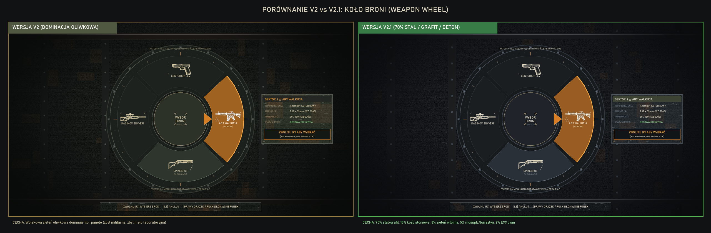
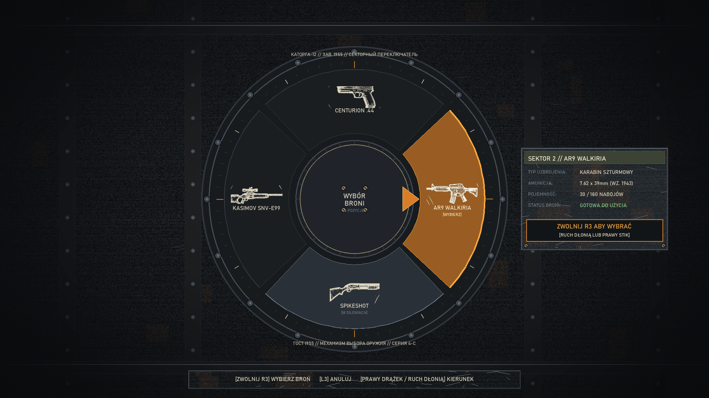
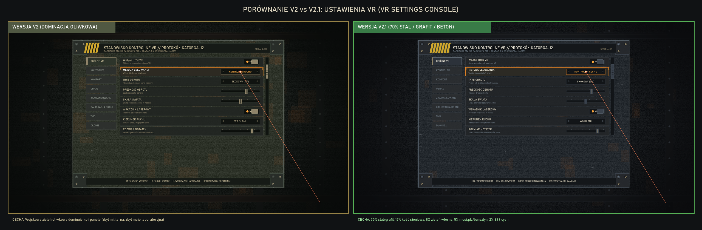
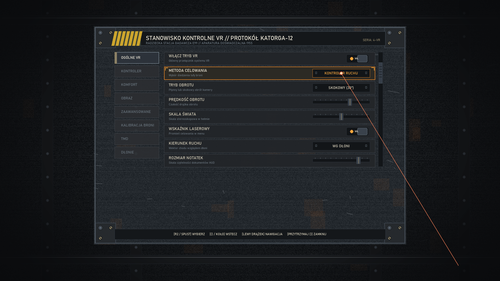
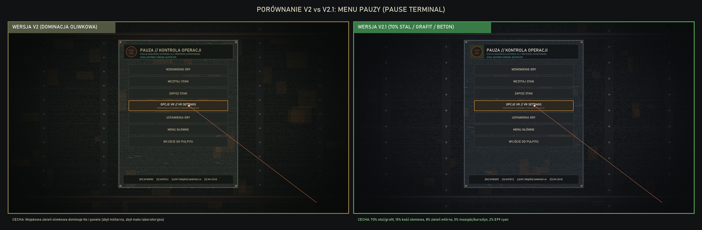
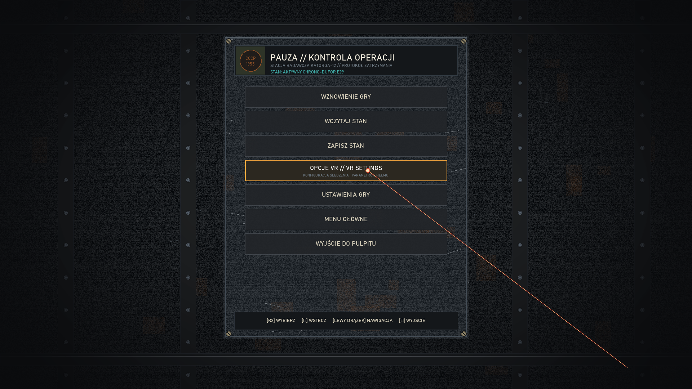

# Singularity VR — Visual Review: Interface & Utility Graphics Remaster

**Package:** Singularity VR UI & Utility Graphics Remaster  
**Role:** Senior Game UI / UX Artist and Technical UI Prototype Designer  
**Branch:** `side/ui-utility-graphics-remaster`  
**Starting Commit:** `e83eb8b` (Baseline)  
**V2 Checkpoint:** `aa52d31` (Soviet Industrial — Olive Dominant)  
**Current Checkpoint:** V2.1 Color Direction Correction — Weathered Gray Steel & Graphite  
**Status:** Visual Checkpoint Candidates Generated — Awaiting Visual Approval Before Full Asset Library Regeneration  

---

## 1. Executive Summary: V2.1 Color Direction Correction

Following user feedback on the V2 checkpoint (`aa52d31`), while the authentic Soviet industrial direction was acknowledged as significantly better, **military olive green was still too dominant across all surfaces**. The UI felt like generic military field hardware rather than an **abandoned Soviet research facility** inside Katorga-12.

In V2.1, the material hierarchy and color balance have been systematically rebalanced without desaturating or flattening the surface details.

### Target Material Proportions in V2.1:
- **70% Weathered Gray Steel, Graphite, Ash & Concrete:** The primary visual identity across all chassis plates, console faceplates, rotary sectors, and terminal slates. Finished in deep cold-rolled steel (`#24292E`), dark graphite (`#1C2024`), scratched bare steel bevels (`#6C7882`), and ash/soot undertones (`#202428`).
- **15% Aged Ivory Enamel & Readable Markings:** Stenciled high-contrast typography in DIN 1451 / Bahnschrift (`#DDD6C0` to `#F4EEDE`), fully readable through PSVR2 optics. All user-facing UI is in clear Polish.
- **8% Faded Military Olive:** Strictly secondary accent bands, inspection tags, clipboard headers, and structural backing brackets (`#3C4234`).
- **5% Rust, Worn Brass Hardware & Vacuum Tube Amber:** Realistically accumulated crevice oxidation (`#884E26`), knurled brass hardware (`#8C8166`), and warm vacuum-tube amber selection/indicator lighting (`#D97E26` / `#F8A83E`).
- **2% E99 Cyan:** Rare, concentrated Element-99 energy filaments (`#41AFAA` / `#82F0EB`), strictly restricted to active temporal cores.

---

## 2. V2 vs V2.1 Side-by-Side Comparisons & Concept Mockups (1920×1080)

---

### Checkpoint Target 1: Weapon Wheel — Soviet Mechanical Selector

#### Side-by-Side Comparison (V2 Olive vs V2.1 Gray Steel)

- Comparison File: [compare_weapon_wheel_v2_1.png](file:///C:/Users/Trilex/vr-mods/SingularityVR-ui-utility-remaster/docs/previews/ui_remaster/mockups/compare_weapon_wheel_v2_1.png)

#### Revised Concept Mockup (1920×1080)

- High-Res Mockup: [weapon_wheel_mockup_v2_1.png](file:///C:/Users/Trilex/vr-mods/SingularityVR-ui-utility-remaster/docs/previews/ui_remaster/mockups/weapon_wheel_mockup_v2_1.png)

#### Rebalancing & Engineering Details:
- **Primary Chassis (70%):** Outer dial housing and mechanical sector plates converted from olive paint to heavy oxidized cast-iron and cold-rolled dark steel (`#1C2024` to `#24292E`), textured with realistic micro-grain, horizontal striations, and bare steel scratched chamfers (`#6C7882`).
- **Olive Restricted to Accent (8%):** Olive drab is confined to subtle inner backing borders and clipboard telemetry header bands (`#3C4234`).
- **Audited 4-Slot Weapon Catalog:** Fully adheres to audited `SingularityVR` weapon slots:
  1. Top (Sector 1): **Centurion .44** (heavy revolver)
  2. Right (Sector 2): **AR9 Walkiria** (assault rifle) — *Selected State* with warm vacuum tube amber backlight (`#D97E26`)
  3. Bottom (Sector 3): **Spikeshot** (shotgun) — *Held in hands* indicator with brighter weathered steel
  4. Left (Sector 4): **Kasimov SNV-E99** (precision sniper rifle)
- **Authentic Weapon Silhouettes (15%):** Genuine silhouette geometry loaded from reference assets (`references/icon-*-final.png`), finished in aged ivory enamel.
- **Center Hub & Telemetry:** Heavy knurled brass pointer needle index pointing to selected sector, with Polish telemetry readouts (`KALIBER: 7.62x39mm`, `MAGAZYNEK: 30 / 180`, `[ZWOLNIJ R3] WYBIERZ`).

---

### Checkpoint Target 2: VR Settings — Worn Laboratory Control Console

#### Side-by-Side Comparison (V2 Olive vs V2.1 Gray Steel)

- Comparison File: [compare_vr_settings_v2_1.png](file:///C:/Users/Trilex/vr-mods/SingularityVR-ui-utility-remaster/docs/previews/ui_remaster/mockups/compare_vr_settings_v2_1.png)

#### Revised Concept Mockup (1920×1080)

- High-Res Mockup: [vr_settings_screen_mockup_v2_1.png](file:///C:/Users/Trilex/vr-mods/SingularityVR-ui-utility-remaster/docs/previews/ui_remaster/mockups/vr_settings_screen_mockup_v2_1.png)

#### Rebalancing & Engineering Details:
- **Primary Chassis (70%):** The 1200×840 console plate is rendered in authentic weathered gray laboratory steel and graphite (`#24292E` / `#343B42`), with concrete/ash environment backing (`#202428`). It features milled steel recessed slider tracks, chipped bare metal edges, and slotted brass chassis corner brackets.
- **Olive Restricted to Accent (8%):** Olive appears strictly as an industrial inspection strip along the top console edge and section tag backing (`#3C4234`), removing the overwhelming green cast.
- **Physical Laboratory Instrumentation:**
  - **Mechanical Toggle Switches:** Recessed steel wells with two-position metal bat levers and warm amber indicator bulbs (`WŁ.` / `WYŁ.`).
  - **Recessed Calibration Sliders:** Recessed steel scale with engraved millimeter calibration ticks and knurled brass slider handle (`#8C8166`).
  - **Active Focus Frame:** Selected row (`METODA CELOWANIA`) highlighted by a brass mechanical focus bezel with corner notches and warm amber glow—no neon cyan borders!
  - **Section Tabs:** Stamped steel plates with clear Polish headers (`OGÓLNE VR`, `KONTROLER`, `KOMFORT`, `OBRAZ`, `ZAAWANSOWANE`, `KALIBRACJA BRONI`, `TMD`, `DŁONIE`).
- **Collimated Optical Pointer:** Precision laser beam and focal target dot simulating an optical laboratory laser pointer.

---

### Checkpoint Target 3: Pause Menu — Aged Industrial Operations Terminal

#### Side-by-Side Comparison (V2 Olive vs V2.1 Gray Steel)

- Comparison File: [compare_pause_menu_v2_1.png](file:///C:/Users/Trilex/vr-mods/SingularityVR-ui-utility-remaster/docs/previews/ui_remaster/mockups/compare_pause_menu_v2_1.png)

#### Revised Concept Mockup (1920×1080)

- High-Res Mockup: [pause_menu_mockup_v2_1.png](file:///C:/Users/Trilex/vr-mods/SingularityVR-ui-utility-remaster/docs/previews/ui_remaster/mockups/pause_menu_mockup_v2_1.png)

#### Rebalancing & Engineering Details:
- **Primary Chassis (70%):** The 680×840 terminal plate is built from cold-rolled dark graphite steel (`#1C2024` to `#24292E`), mounted with slotted corner fasteners over dark soot/ash concrete.
- **Olive Restricted to Accent (8%):** Olive drab is limited to the header document strip backing the brass serial seal (`#3C4234`), eliminating full-plate olive fill.
- **Stamped Hardware & Enamel Buttons:**
  - Header plate with Soviet laboratory seal (`СССР 1955 // КАТОРГА-12`) and Polish title: `PAUZA // KONTROLA OPERACJI`.
  - Heavy mechanical push-plates with ivory stenciled lettering (`WZNOWIENIE GRY`, `WCZYTAJ STAN`, `ZAPISZ STAN`, `OPCJE VR`, `USTAWIENIA GRY`, `MENU GŁÓWNE`, `WYJŚCIE DO PULPITU`).
  - Dedicated `OPCJE VR` row featuring an aged brass casing, subtle amber backlight (`#7A5626`), and corner focus brackets.
- **Hover & Pointer:** Focused state on `OPCJE VR` with laboratory red-amber laser reticle.

---

## 3. V2.1 Material & Color Calibration Table

| Material Role | Target % | Hex Code | RGB | Visual Character |
|---|---|---|---|---|
| **Deep Graphite Chassis** | **70%** | `#1C2024` | `(28, 32, 36)` | Base chassis metal, switch wells, dark faceplates |
| **Weathered Gray Steel** | **70%** | `#24292E` | `(36, 41, 46)` | Main console faceplates, rotary wheel sectors, plates |
| **Cold-Rolled Steel Plate**| **70%** | `#343B42` | `(52, 59, 66)` | Elevated panels, bezels, mechanical push-buttons |
| **Bare Steel Chipped Edge**| **70%** | `#6C7882` | `(108, 120, 130)`| Scratched highlights, worn corners revealing bare metal |
| **Concrete & Ash Undertone**| **70%** | `#202428` | `(32, 36, 40)` | Dark background environment, soot, dirty crevices |
| **Aged Ivory Typography** | **15%** | `#DDD6C0` | `(222, 214, 192)`| High-contrast stenciled lettering (Polish UI text) |
| **Bright Ivory Enamel** | **15%** | `#F4EEDE` | `(244, 238, 222)`| Active headers, selected row text, calibration marks |
| **Secondary Olive Accent** | **8%** | `#3C4234` | `(60, 66, 52)` | Faded inspection tags, clipboard headers, backing bars |
| **Muted Olive Tag** | **8%** | `#2E3428` | `(46, 52, 40)` | Secondary equipment borders and dark accents |
| **Weathered Brass Hardware**| **5%** | `#8C8166` | `(140, 129, 102)`| Milled knobs, screws, slider handles, dial needles |
| **Oxidized Crevice Rust** | **5%** | `#884E26` | `(136, 78, 38)` | Realistic seam oxidation, patina around screw heads |
| **Selector Amber Light** | **5%** | `#D97E26` | `(217, 126, 38)` | Vacuum-tube amber backlight for selected rows & sectors |
| **Bright Amber Bulb** | **5%** | `#F8A83E` | `(248, 168, 62)` | Active switch indicator lamps, high-priority warnings |
| **Restrained E99 Cyan** | **2%** | `#41AFAA` | `(65, 175, 170)` | Active Element-99 core filaments only (isolated) |
| **E99 Core Filament** | **2%** | `#82F0EB` | `(130, 240, 235)`| Focused energy core luminescence (strictly restrained) |

---

## 4. Checkpoint Protocol & Next Steps

1. **Full Asset Library Regeneration Remains Paused:**
   - In accordance with checkpoint guidelines, slice and atlas regeneration for all 300+ individual UI assets remains on hold.
2. **Review & Approval Gate:**
   - Please review the V2 vs V2.1 side-by-side comparisons and the revised 1920×1080 mockups.
   - Once the gray steel & graphite material balance (70/15/8/5/2) is confirmed, the full asset production pipeline will be updated to export all vector SVG sources, sliced PNGs, and texture atlases.
