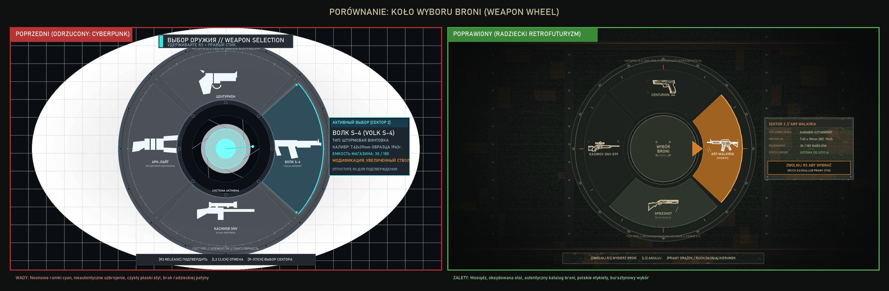
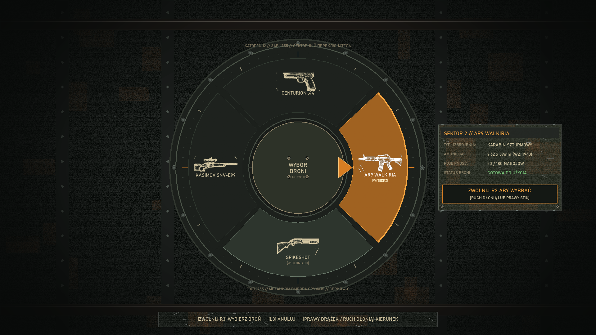
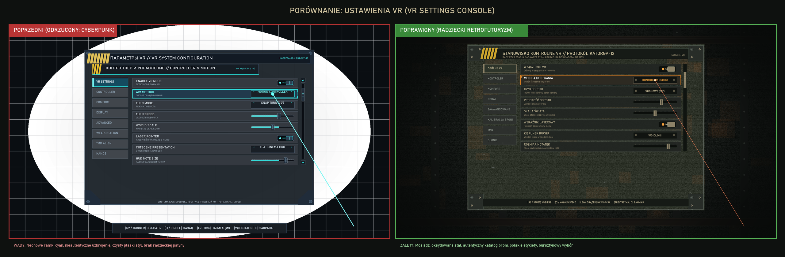
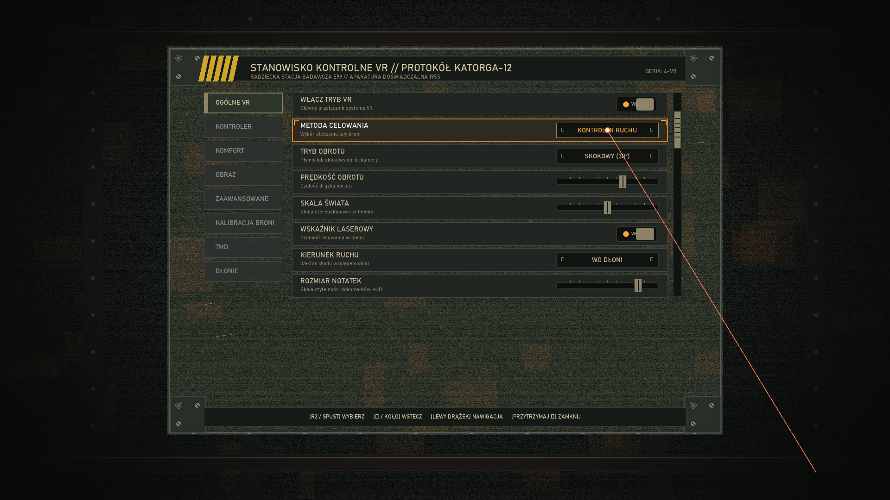
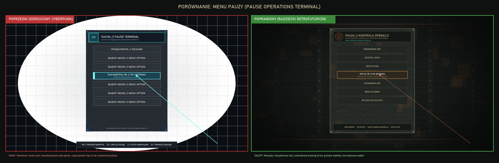
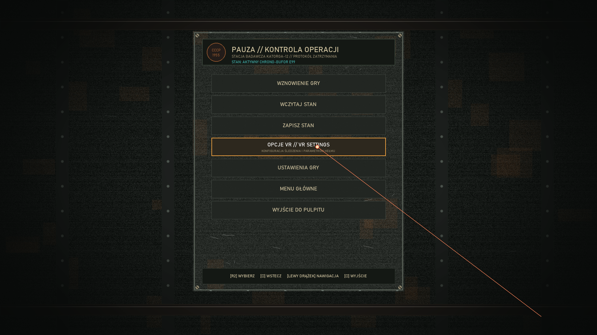

# Singularity VR — Visual Review: Interface & Utility Graphics Remaster

**Package:** Singularity VR UI & Utility Graphics Remaster  
**Role:** Senior Game UI / UX Artist and Technical UI Prototype Designer  
**Branch:** `side/ui-utility-graphics-remaster`  
**Starting Commit:** `e83eb8b`  
**Checkpoint:** Art Direction Correction (v2) — Soviet Industrial Retrofuturism  
**Status:** Visual Checkpoint Candidates Generated — Awaiting Visual Approval Before Asset Library Regeneration  

---

## 1. Art Direction Correction Overview (v2 Checkpoint)

Following user feedback on baseline `e83eb8b`, the interface remaster has undergone a fundamental art direction correction. The previous candidate was rejected as **too clean, too modern, and excessively cyberpunk** (heavy electric cyan neon glows, floating holographic cards, SaaS dashboard widgets, and inaccurate loadouts).

### Revised Core Metaphor
> *A heavy military control console manufactured in a Soviet research facility in 1955, abandoned for decades inside Katorga-12, then modified with crude experimental Element-99 laboratory instrumentation.*

### Key Changes Across All Systems:
1. **Material Realism:** Replaced glossy digital backings with oxidized cast iron, chipped dark olive drab paint (`#3E4436`), worn brass (`#8E8369`), and exposed bare steel edges (`#737D78`) with subtle corrosion and scratches.
2. **Restrained E99 Cyan:** Eliminated electric cyan neon outlines around every border. Cyan is strictly concentrated on rare active E99 filaments, core aperture lenses, and confirmation events.
3. **Warm Soviet Amber:** Interactive selection and focus states now use warm vacuum-tube amber/orange (`#D77D23`), matching the original game's gauge lights.
4. **Authentic Audited Loadout:** Replaced invented weapon designations ("Volk S-4", "ARCLight") with the real audited 4-slot catalog order from `SingularityVR`: **Centurion .44**, **AR9 Walkiria**, **Spikeshot**, and **Kasimov SNV-E99**.
5. **Polish Primary Language:** All functional, user-facing UI text is in clear Polish, using authentic Cyrillic only on historical stamped equipment plates (`ГОСТ 1955 // КАТОРГА-12`).

---

## 2. Mandatory Visual Checkpoint: 3 Revised Mockups & Side-by-Side Comparisons

---

### Checkpoint Target 1: Weapon Wheel — Soviet Mechanical Selector

#### Side-by-Side Comparison

#### Revised Concept Mockup (1920×1080)

- Direct Path: [`docs/previews/ui_remaster/mockups/weapon_wheel_mockup_v2.png`](file:///docs/previews/ui_remaster/mockups/weapon_wheel_mockup_v2.png)
- Comparison Path: [`docs/previews/ui_remaster/mockups/compare_weapon_wheel.png`](file:///docs/previews/ui_remaster/mockups/compare_weapon_wheel.png)

#### Design Transformation:
- **Cyberpunk Elements Removed:**
  - Removed bright cyan outer neon rings, digital radar ticks, and glowing blue arc-reactor center core.
  - Removed floating holographic HUD stats card and sci-fi grid overlay.
  - Removed incorrect weapon designations ("Volk S-4" and "ARCLight") that contradicted project slot specifications.
- **Soviet Industrial Replacements:**
  - **Outer Housing:** Heavy oxidized cast-iron instrument dial casing with 16 perimeter hex bolts, engraved 360-degree ticks, and factory stamp `КАТОРГА-12 // ЗАВ. 1955 // СЕКТОРНЫЙ ПЕРЕКЛЮЧАТЕЛЬ`.
  - **Engraved Mechanical Sectors:** 4 physical wedges in audited catalog order:
    1. Top (Sector 1): **Centurion .44** (heavy revolver)
    2. Right (Sector 2): **AR9 Walkiria** (assault rifle) — *Selected state* highlighted in warm Soviet amber (`#D77D23`).
    3. Bottom (Sector 3): **Spikeshot** (shotgun) — *Held in hands* indicated by brighter weathered steel.
    4. Left (Sector 4): **Kasimov SNV-E99** (precision sniper rifle).
  - **Authentic Weapon Silhouettes:** Loaded directly from mod reference assets (`references/icon-*-final.png`), rendered in worn aged ivory enamel (`#D3C6A2`).
  - **Center Hub:** Heavy milled knurled brass selector knob with physical mechanical pointer needle index pointing to the selected sector, stamped with Polish label `WYBÓR BRONI`.
  - **Callout Plate:** Heavy dark olive clipboard plate displaying Polish weapon telemetry (`KALIBER: 7.62x39mm`, `MAGAZYNEK: 30 / 180`, `[ZWOLNIJ R3] WYBIERZ`).

---

### Checkpoint Target 2: VR Settings — Worn Laboratory Control Console

#### Side-by-Side Comparison

#### Revised Concept Mockup (1920×1080)

- Direct Path: [`docs/previews/ui_remaster/mockups/vr_settings_screen_mockup_v2.png`](file:///docs/previews/ui_remaster/mockups/vr_settings_screen_mockup_v2.png)
- Comparison Path: [`docs/previews/ui_remaster/mockups/compare_vr_settings.png`](file:///docs/previews/ui_remaster/mockups/compare_vr_settings.png)

#### Design Transformation:
- **Cyberpunk Elements Removed:**
  - Removed cyan neon borders around every row, toggle, and slider.
  - Removed modern SaaS/dashboard layout feel and glowing digital fill bars.
  - Removed electric blue lightsaber laser beam and giant glowing target flare.
  - Removed Russian header titles.
- **Soviet Industrial Replacements:**
  - **Chassis:** 1200×840 console plate made of dark olive-drab paint over oxidized steel, with chipped edges showing bare metal and corner corrosion. Reinforced by 4 heavy corner brackets with slotted brass screws and hex bolts.
  - **Physical Controls:**
    - **Toggle Switches:** Physical two-position Soviet toggle switches (`przełącznik hebelkowy`) in recessed steel wells with metal bat levers and amber indicator bulbs (`WŁ.` / `WYŁ.`).
    - **Sliders:** Recessed calibration track cut into the steel plate with engraved millimeter ticks and a heavy knurled brass slider handle.
    - **Row Focus:** Selected row (`METODA CELOWANIA`) features a subtle warm amber/brass mechanical focus frame with corner notches—zero cyan neon!
    - **Section Tabs:** Stamped metal nameplates with Polish titles (`OGÓLNE VR`, `KONTROLER`, `KOMFORT`, `OBRAZ`, `ZAAWANSOWANE`, `KALIBRACJA BRONI`, `TMD`, `DŁONIE`).
  - **Optical Laboratory Laser:** Replaced futuristic blaster beam with a fine collimated optical beam and precision target dot.

---

### Checkpoint Target 3: Pause Menu — Aged Industrial Operations Terminal

#### Side-by-Side Comparison

#### Revised Concept Mockup (1920×1080)

- Direct Path: [`docs/previews/ui_remaster/mockups/pause_menu_mockup_v2.png`](file:///docs/previews/ui_remaster/mockups/pause_menu_mockup_v2.png)
- Comparison Path: [`docs/previews/ui_remaster/mockups/compare_pause_menu.png`](file:///docs/previews/ui_remaster/mockups/compare_pause_menu.png)

#### Design Transformation:
- **Cyberpunk Elements Removed:**
  - Removed floating translucent holographic card and glowing blue E99 badge.
  - Removed flat modern buttons with electric blue outlines.
  - Removed digital cyan laser streak.
- **Soviet Industrial Replacements:**
  - **Chassis:** Physical Cold War operations terminal slate (680×840) made of dark graphite cast iron with weathered dark olive bezel, secured with corner flathead screws.
  - **Identification Plate:** Stamped brass and dark enamel header plate featuring a faded red Soviet Katorga-12 seal (`СССР 1955`) and primary Polish title: `PAUZA // KONTROLA OPERACJI`.
  - **Mechanical Push-Plates:** Recessed heavy dark metal buttons with ivory stamped lettering (`WZNOWIENIE GRY`, `WCZYTAJ STAN`, `ZAPISZ STAN`, `OPCJE VR`, `USTAWIENIA GRY`, `MENU GŁÓWNE`, `WYJŚCIE DO PULPITU`).
  - **Dedicated Synthetic "OPCJE VR" Row:** Highlighted with an aged brass casing, warm amber backlight (`#7A5626`), and corner focus notches, integrating naturally into the physical apparatus.
  - **Precision Optical Laser:** Accurate laboratory collimator dot hovering on the target button without digital bloom.

---

## 3. Revised Material & Color Palette

| Material / Element | Hex Code | Visual Character & Role |
|---|---|---|
| **Graphite Base** | `#262A26` | Cold-rolled cast iron chassis, recessed machinery wells |
| **Dark Military Olive** | `#3E4436` | Soviet military equipment enamel, chipped at worn edges |
| **Weathered Brass** | `#8E8369` | Milled knobs, nameplates, selector needle, screws |
| **Aged Ivory** | `#D3C6A2` | High-contrast stenciled typography (DIN 1451 / Bahnschrift) |
| **Oxidized Rust** | `#91552D` | Realistic edge corrosion, patina in recessed seams |
| **Selector Amber** | `#D77D23` | Warm analog vacuum-tube glow for active sector & focus |
| **Restrained E99 Cyan** | `#41AFAA` | Rare, strictly concentrated Element-99 energy filaments |

---

## 4. Next Steps & Approval Protocol

In accordance with the Mandatory Visual Checkpoint instructions:
1. **Full Asset Library Regeneration is Paused:** Vector atlases, PNG icon sheets, and utility slices will only be regenerated once the user reviews and confirms these three concepts.
2. **Feedback Requested:** Please confirm whether the Soviet industrial material weathering, Polish terminology, audited 4-slot layout, and restrained amber/brass palette meet expectations for Singularity VR.
