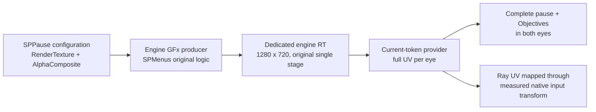

# MAIN proposal: use the engine's native pause RenderTexture

**Candidate, default off; no runtime PASS.** Asset evidence and offline proof
are in `pause-menu-deep-re.md`. It is a property-driven native producer route,
not a D3D capture patch. No new native function address is assumed.

Update: a dedicated, recompressed asset and repack-only control now exist outside
Git. See [prototype handoff](pause-native-rtt-prototype.md) for current tests,
verified default/class/enum findings, integration gaps and the bounded runtime gate.
The earlier paragraph below describing only a property-stream experiment is historical.

## Mechanism

The authored `SPPause` instance lacks a serialized RenderTexture override.
Other instances using the same `SPMenus` assign `RTT_UI1/RTT_UI2` with
`RTM_AlphaComposite`. Investigate giving pause its own compatible engine
TextureRenderTarget2D before GFx initializes the movie. The engine would then
produce the complete 1280×720 layout, including the Objectives callback;
the existing provider could deliver full UVs to both eyes.

## Exact observation gate

MAIN can add one read-only probe at `NativeVrUi::UpdateMenu` focus transition,
using existing `PropOffsetInChain` in `d3d9.cpp` to resolve **named** reflected
properties on the actual live class, never hardcoded member offsets. Read
MovieInfo, RenderTexture and RenderTextureMode for SPMain and SPPause and log
their object names/classes. If property-layout prerequisites are unavailable,
log UNKNOWN and stop. The enum's live ordinal must be reflected/validated;
the package's FName enum serialization is not an in-memory byte value.

Then record one RT0 lifecycle through existing `Hook_SetRenderTarget` and
`Hook_SetTexture`, correlating the engine texture object with its RHI/D3D
surface. That object-to-resource mapping is currently unknown. Do not infer
it merely from dimensions. Identify whether switching RenderTexture requires
movie close/reopen, initialization, or publication to the render thread.

**Abort:** live pause already has a valid RTT but still bypasses it; property
not reflected; a shared RTT can be overwritten by another menu; no proven
initialization/ownership route; or input coordinate transform cannot be proven.

## Prototype scope after observation passes

Prefer an isolated cooked-asset variant in a developer game copy, configuring
SPPause **before engine initialization**, instead of mutating a live movie.
Offline tests already inserted 60 bytes of native property tags into its export
and validated all serial offsets/other movie properties; they did not produce
a loader-validated/recompressed package. Package loading/override resolution
is a separate gate. Never replace the installed Steam package from this branch.

Do not reuse RTT_UI2 for a final design: it is shared by other authored menus.
A dedicated target needs verified construction/serialization or an engine
resource creation route. The existing target is only a controlled isolated
prototype comparator. Do not patch Stage.scaleMode globally.

## Minimal eventual integration seams

- Engine asset/configuration: SP pause's RenderTexture and mode only. Retain
  original SPMenus bytecode, native delegates, Objective content and options.
- `CaptureVrMenuTarget` / `SyncVrMenuCaptureState` in `vr_menu_overlay.h`:
  accept the **proven exact** target at producer completion under the current
  token. Binding it alone does not prove completed pixels.
- `DrawVrMenuPointer`: full `[0,1]²` texture per eye, original gameplay SBS
  untouched; a true OpenXR quad can be evaluated later.
- `NativeVrUi::Coordinates`: measured inverse map from panel UV to native
  FViewport/GFx coordinates. Current FViewport remains 5264×2684; assigning an
  RTT does not prove the old full-width mapping still works. No hand changes.
- Suppression: enable only after both content and provider presentation succeed.
  Off flag preserves native rendering/input. Restore original property/config
  and release token-owned resources on close/reset, using engine lifecycle.

## One bounded validation run for MAIN

Capture native RTT RGB **and alpha** after completion in root pause and after
Objective updates. Both normal options and Objectives must be readable in the
same mono texture. Save independent eye images; both must contain the full
page, with no SBS double-world or half crop. Verify normal row hover/click,
Objectives scrolling/update, Options open/back, Resume, repeated pause close,
and class/token transitions. A frame/band counter is insufficient.

For the isolated RTT change, also log RT0/depth/viewport/stream/constant
invariants before and after pause and confirm no gameplay-state differences.
Physical PSVR2 acceptance remains MAIN's gate. Immediate rollback is flag off
for mod routing and restoration of the original isolated asset/config before
relaunch; keep the accepted Steam build unchanged until MAIN authorizes its
own integration workflow.
