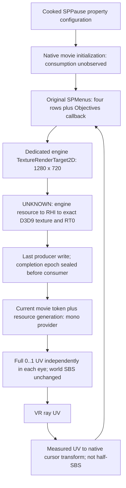

# MAIN handoff: dedicated native pause RTT prototype

Status: **offline structural/codec PASS; native loader, completed pixels and input UNVERIFIED.**
Continuation of `a15a09b`; no production code, Steam files or accepted DLL changed.
Preferred next experiment is the original GFx producer, not batch replay or SBS duplication.

## Concrete initialization findings

Targeted inspection of decoded `GFxUI.u` and `RvGame.u` establishes:

- Actual class chain: `RvUIGFxMovie_Pause -> RvUIGFxMovie -> GFxMovie -> Object`.
  `Default__RvUIGFxMovie_Pause` (serial `0x46296C`) and
  `Default__RvUIGFxMovie` (`0x3CD038`) have no tagged overrides.
  `Default__GFxMovie` (`0xF9E5`) only sets `bGammaCorrection=true`.
  Therefore there is **no serialized inherited RTT assignment**. A constructor,
  Raven initialization or later live assignment remains unobserved.
- `GFxMovie.RenderTexture` is an ObjectProperty constrained to
  `TextureRenderTarget2D` (property serial `0xB068`); `RenderTextureMode`
  is a ByteProperty (`0xAD1C`). Enum native tail at `0xB1C4` establishes
  `RTM_Opaque=0`, `RTM_Alpha=1`, `RTM_AlphaComposite=2`.
  Ordinal 2 does **not** prove the actual D3D alpha blend convention.
- `SPMain` explicitly references imported RTT_UI1; local RTT_UI2 is shared by
  other movies. Neither is safe as the permanent pause resource.
- `SPPause` export 22 references the same `SPMenus` as SPMain. Original
  `SetupPauseMenu` creates all four normal rows AND `PauseMenuObjectives` under
  Content. The native callback updates `Objectives.htmlText`. This makes one
  movie-level producer a concrete candidate for both, **not proof of one live RTT**.
- Correction to earlier uncertainty: package class/outer chains establish that
  GFxMovie owns GetVariable* functions and pause inherits that class. Their serial
  offsets are **not executable addresses or validated calling conventions**.
  No new native calls were made.

The prototype supplies configuration during package deserialization, before any
movie Start/OnStart using that object. Exactly when native code consumes it,
whether Raven replaces it, and whether a live change requires reconstruction
are UNKNOWN. Do not attempt live switching on this evidence.

## Built artifact, outside Git

Lab root: `C:/Users/Trilex/vr-mods/pause-re-lab`.

- Candidate: `native-rtt-dedicated-v1/UI_SinglePlayer_SF.xxx`, 786432 bytes,
  SHA256 `5b2ea469a3ee06ff154ac78bd58604e8034970d4837f289e5c22503c6a673cde`.
- Repack-only control: `native-rtt-control-v1/UI_SinglePlayer_SF.xxx`, 786432 bytes,
  SHA256 `99e943c7a2fef75c0375101e17fe224532e81055a4fb1d4331bca7279eb8228c`.
- Original cooked source SHA256:
  `c8cdb2e193b53781d7634eee88f2dc90fd168b5dcc639098441a2b489386984f`.
  Extracted logical input pinned by builder to `90a5ca7efffcce7bea8a201e99b8313f4a276c270657e5b521dc9ede8f4101c6`.

Candidate adds only the RTT_VRPause name, dedicated export 45 under
`UI_FX.Textures`, empty depends entry, and 60 bytes of engine-authored property
tags to SPPause pointing to export 45 with AlphaComposite. It clones RTT_UI2's
1280x720 clamp/Scaleform-only/two-copy configuration, assigns NetIndex=-1,
preserves existing object indices, and relocates declared inline texture bulk
offsets. Header growth is 96 bytes; pause growth 60; new target 204.
SPMenus and all unrelated exports remain byte-identical except declared absolute
bulk-pointer relocation. No bytecode, input delegates or Stage.scaleMode edits.

Compression is valid literal-only LZO1X in six 128KiB UE3 blocks, with correct
physical/logical chunk map and store-compressed flags; the larger size is intentional.
Independent C++ decoder round-trips every byte (normalizing the compressed flag),
and `uepkg` reports 227 names / 26 imports / 45 exports, zero bad references,
zero gaps/overlaps. Control decodes exactly to the original logical input.
These establish **format consistency**, not acceptance by Singularity's loader.
The tiny shader cache contains zero shader/material bodies; builder refuses
unknown layouts instead of guessing relocation sites.

## Texture flow and source-level integration



Exact seams in this research base (MAIN must reconcile its current branch):

- `native_ui_input.h:36`, `NativeVrUi::UpdateMenu`: existing focus/movie/class
  transition; add bounded read-only named-property observation via
  `d3d9.cpp:1859`, `PropOffsetInChain`. Validate property types, readable bounds,
  object identity and reflected class chain; log UNKNOWN if prerequisites fail.
- `d3d9.cpp:11550`, `Hook_SetRenderTarget`: presently calls the original first
  and registers dimension candidates at `11612`. For a diagnostic, retain the
  **outgoing** proven RT0 before the call; a successful switch-away is a potential
  write-interval end, NOT whole-movie completion. Failed binds end nothing.
  `Hook_SetTexture` (`18982`) gives a consumer boundary; `Hook_Present` (`23217`)
  gives the last pre-provider checkpoint. Trace last writes and later rebinds.
- **Missing exact seam:** no verified native RTT creation/completion address,
  object-to-RHI offset or render-thread publication protocol was found. Required
  evidence is a resource-creation/bind call stack tied to the reflected
  RTT_VRPause object, followed through its exact RHI/D3D texture and level-0
  surface. Dimensions/name/timing alone are not identity proof. Do not add a
  guessed pointer walk or UFunction call. Asset naming proves package separation,
  not that native resource allocation cannot alias.
- `vr_menu_overlay.h:302`, `CaptureVrMenuTarget`: replace aspect/size selection
  for this opt-in path with that exact identity and a sealed completion epoch.
  A nonzero draw count or COM AddRef does not establish content completion.
  Keep an engine-produced texture, not a pooled GFx replay target. Sampling and
  readback must be ordered after producer commands; avoid sampling an active RT.
- `SyncVrMenuCaptureState` (`285`) / `ReleaseVrMenuResources` (`346`): invalidate
  token and resource generation on close, focus change, reset/recreation; release
  COM references. Never destroy the engine's UObject. Retained static pixels may
  be reused while token/resource are valid; callback writes create a new epoch.
- `DrawVrMenuPointer` (`357`, full-UV construction near `407`): present one verified
  mono texture twice, not the world/SBS composite. Measure alpha representation
  before choosing premultiplied vs straight blending (current code uses SRCALPHA).
  Preserve explicit RT0/DS restoration in addition to the state block; check all
  HRESULTs and viewport/scissor/stream/shader/constants on exit.
- `NativeVrUi::Coordinates` (`65`): only this path's coordinate transform changes
  after measurement; keep native GetX/GetY/GetPos and Drain action routing intact.
  No production changes on SIDE; these are integration requirements, not a patch.

## Input: exact missing observation and bounded solution

Authored stage is 1280x720, but `noscale` and Stage.safeRect drive placement;
Objectives uses safeRect.width and its own width. RTT size alone proves neither
safeRect nor cursor units. Current Coordinates maps panel UV to 5264x2684 FViewport.
Do not use `(u*1280,v*720)` or divide native X by two without evidence.

Collect at least three non-collinear texture-UV/native-cursor landmark pairs and
two held-out pairs, including a normal row and Objectives region. Obtain UV from
the actual completed texture and native cursor from existing getters with native
hover/selection feedback. Fit `x=a*u+b*v+c; y=d*u+e*v+f`; require held-out errors
under 2 native pixels and correct row hits. If scale/translation is insufficient,
stop and observe safeRect/viewport behavior through a validated interface rather
than inventing an AS getter path. Record any observed safeRect and its provenance.
UV to cursor uses the forward measured map; cursor to texture uses its inverse.
Reject out-of-panel rays. Confirm keyboard/gamepad navigation, Options/back,
Resume and Objectives update/scroll if that screen supports scrolling; this audit
does not establish an independently selectable Objectives control.

## One bounded MAIN runtime gate

SIDE does not deploy. MAIN controls the isolated test and any Steam authorization.
Preserve accepted DLL SHA `2FE5011C20DFEAAEDFFFFE58CD39E92A9570867F344649B00C0038AD97B39A47`.
First establish read-only resource identity instrumentation; without it the run
can assess visible behavior but cannot meet the ownership/completion gate.

Budget: one candidate launch, <=5 minutes, first 120 pause frames, <=256 event
records/frame, <=4 RGB+alpha dumps total, three pause open/close cycles. Ring-buffer
overflow is UNKNOWN, not PASS. No stereo tweaks during the test.

1. With game closed, MAIN backs up original package outside CookedPC, records
   original/candidate/DLL hashes, installs only its authorized candidate, then launches.
   Log package load success plus live pause MovieInfo, RenderTexture identity/name,
   mode and target dimensions. Log original baseline assignment if already available.
2. At proven producer exit/pre-consumer and immediately before existing provider,
   record token, frame/event index, last-write epoch, UObject/RHI/texture/surface
   identities, RT0/DS, viewport/scissor, draw/write counts and HRESULTs. Deferred
   readback of completed texture must preserve source ordering and device state.
3. Dump **RGB and alpha separately** for root pause and after an actual Objectives
   change. The SAME uncropped image must show Return to Game/other rows AND readable
   Objectives, with one continuous layout, no left/right scene pair. Alpha must
   cover the labels; do not infer correct alpha from RGB. If no update occurs in
   this scenario, callback freshness remains UNVERIFIED, not a failure or PASS.
4. Save both submitted eye images and verify both contain the whole menu with
   unchanged gameplay stereo. Test held-out cursor landmarks and native navigation.
   Log state before/after provider plus after Resume; check resource identity across
   reopen, no stale previous-token texture, no state leak or gameplay regression.

**GO:** loader and live configuration match, exact resource provenance is proven,
complete mono RGB/alpha and Objective freshness are proven before consumption,
both eyes show it, native interaction and state/lifetime invariants pass.
**NO-GO / UNKNOWN:** any missing proof stops integration, without retrying c5,
viewport/scissor remaps or world-SBS copying. On loader failure, restore original
immediately; use repack-only control in a separately authorized follow-up to isolate
codec/container vs dedicated-export failure. If asset loading cannot be made safe,
observe reflected properties before validated initialization as the alternative;
no live writes/calls without an established lifecycle.

Rollback: close game, restore original package and verify original hash, leave
accepted DLL/settings intact, discard only token-owned diagnostic COM references.
Reverting provider routing alone cannot undo a loaded asset; relaunch is required.

## Reproduce offline (PowerShell, repository root)

```powershell
$pauseLab = 'C:\Users\Trilex\vr-mods\pause-re-lab'
python tools/pause-re/build_rtt_asset.py "$pauseLab\UI_SinglePlayer_SF.u" --mode dedicated --output-dir "$pauseLab\native-rtt-dedicated-v2"
python tools/pause-re/build_rtt_asset.py "$pauseLab\UI_SinglePlayer_SF.u" --mode control --output-dir "$pauseLab\native-rtt-control-v2"
# Build these two offline tools in a VS x86 developer shell; GPL decoder is not linked into mod.
cl /nologo /EHsc /W4 /O2 /MD /std:c++17 tools/pause-re/unpack_ui_chunks.cpp /Fo"$pauseLab\unpack_ui_chunks.obj" /Fe"$pauseLab\unpack_ui_chunks.exe"
cl /nologo /EHsc /W4 /O2 /MD /std:c++17 tools/uepkg/uepkg.cpp /Fo"$pauseLab\uepkg.obj" /Fe"$pauseLab\uepkg.exe"
& "$pauseLab\unpack_ui_chunks.exe" "$pauseLab\native-rtt-dedicated-v2\UI_SinglePlayer_SF.xxx" "$pauseLab\native-rtt-dedicated-v2\cpp-decoded.u"
& "$pauseLab\uepkg.exe" "$pauseLab\native-rtt-dedicated-v2\cpp-decoded.u" RTT_VRPause
# Tests use existing v1 artifacts, already decoded independently for BOTH modes:
python tools/pause-re/test_rtt_asset.py $pauseLab
python tools/pause-re/offline_checks.py "$pauseLab\UI_SinglePlayer_SF.u" "$pauseLab\movies\movie-0000af67.swf"
$pausePkg = 'C:\Users\Trilex\vr-mods\SingularityVR-hands-only\deployment\_pkg-out'
python tools/pause-re/probe_defaults.py "$pausePkg\GFxUI.u" Default__GFxMovie --exact
python tools/pause-re/probe_defaults.py "$pausePkg\GFxUI.u" RenderTexture
python tools/pause-re/probe_defaults.py "$pausePkg\RvGame.u" Default__RvUIGFxMovie --exact
python tools/pause-re/probe_defaults.py "$pausePkg\RvGame.u" Default__RvUIGFxMovie_Pause --exact
```

Six tests PASS: tables/tiling, dedicated ownership in serialized references,
byte preservation/declared relocation, deterministic C++ LZO round-trip/control,
unknown-layout refusal, and Git/Steam/overwrite safety. Prior AVM1 assertions PASS.
Initial shader-cache layout hypothesis was refused; corrected parser explicitly
checks the observed zero shader count between CRC maps. No speculative output used.

Format cross-checks: primary [UEViewer bulk serialization](https://github.com/gildor2/UEViewer/blob/master/Unreal/UnCoreSerialize.cpp),
[UE3 texture serialization](https://github.com/gildor2/UEViewer/blob/master/Unreal/UnrealMaterial/UnTexture3.cpp)
and [UObject serialization](https://github.com/gildor2/UEViewer/blob/master/Unreal/UnObject.cpp).
No external implementation copied; original literal encoder, existing GPL offline
decoder, and repository table parser remain separate from the production mod.

Earlier fixes operated on already split/partial draws or unproven size-selected
surfaces. c5 and viewport edits cannot restore missing producer content; full SBS
duplication copies the broken world/menu arrangement; pooled replay lacked proven
whole-movie completion/state/alpha. This candidate instead changes native producer
configuration before initialization, preserving the original single-stage logic.
If its completed RTT still lacks content, that is evidence against the candidate,
not permission to assert that all GFx batches were captured.
