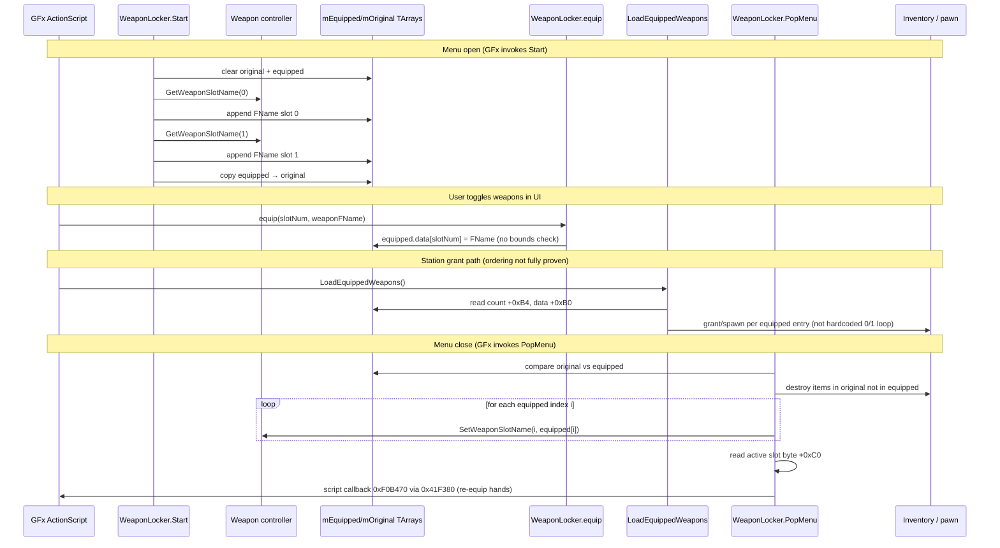

# Native WeaponLocker contract and VR wheel gap — investigation report (2026-10-22)

**Scope:** Evidence-only audit. **No Steam deploy, no runtime hooks, no INI changes** in this work.

**Tools re-run (offline PASS):**

- `python tools/reload/test_locker_runtime_contract.py` — 6/6
- `python tools/reload/inspect_locker_contract.py` — owned `Singularity.exe` + capture text
- `python tools/reload/inspect_locker_runtime_contract.py` — capture `research/etw/capture-20261006-205508/Singularity.text-memory.bin`, base `0x402000`

**Runtime context (Arm A accepted):** `%LOCALAPPDATA%\SingularityVR\view_matrix.log` attach `2026-10-22 11:20:03`, `LockerStationGrantOrdinary=0`, `WeaponWheelOwnedInventory=1`, `KeepAcquiredWeapons=1`. Locker focus: `ownedMask=0x1`, Phase B plan `uiOrdinary=1`; wheel later `ownedMask=0x3` after commits — no crash, no hitch (user confirmed).

---

## 1. Confirmed native identities (Singularity 2010, owned EXE)

| Artifact | Value |
|----------|--------|
| `RvUIGFxMovie_WeaponLocker` vtable | `0x019A0948` |
| `Start` | vtable `+0x11C` → `0x00F11430` |
| `PopMenu` | vtable `+0x190` → `0x00F17F60` |
| `LoadEquippedWeapons` | vtable `+0x1F4` → `0x00F23840` |
| `equip` | vtable `+0x1F8` → `0x00F00F50` |
| Weapon controller getters | vtable `+0x740` GetWeaponSlotName, `+0x744` SetWeaponSlotName |
| GFx movie active slot byte | `+0xC0` (PopMenu re-hand) |
| GFx equipped TArray (script object) | data `+0xB0`, count `+0xB4` (LoadEquippedWeapons witness) |
| GFx reflection (runtime) | `mEquippedWeapons` / `mOriginalWeapons` on movie instance (witness logs offset 176 / 164) |

Helper callees referenced in locker bodies (capture witness): `TArray::Find` `0x00447BA0`, `TArray::Append` `0x0044B0F0`, `destroyItem` `0x00A05790`, `spawnByName` `0x00F00FA0`, script callback push `0x00F0B470` → dispatcher `0x0041F380`.

---

## 2. Native call sequence (locker open → close)

**Start (confirmed):** Rebuilds **only two** entries from controller slots **0 and 1**. Does **not** use equipped count from `+0xB4` for its producer loop.

**equip (confirmed):** Script `slotNum` → store at `equipped.data[slotNum]` with **no capacity check**.

**LoadEquippedWeapons (confirmed):** Iterates **`equipped.Count`** — grant producer for names **already in that array**, not a substitute for Start’s two-slot controller read.

**PopMenu (confirmed):** Inventory diff + **`SetWeaponSlotName(i, …)` for every equipped index `i`**. If **`equipped.Count > 2`**, indices **2+ can overwrite controller slots used for heavy/grenade/special** (offline witness). This risk applies to **GFx/UI paths that grow the equipped TArray past two** — not to an **inventory-only** VR path that never increases that count or never maps extra ordinaries into controller indices ≥ 2.

---

## 3. Three distinct concepts (do not conflate)

These are **orthogonal**. The VR wheel bug class comes from mixing them.

### 3.1 Station weapon **availability**

- **Meaning:** Which ordinary weapons **this weapon station level design allows the player to choose among** (often four archetypes in product intent).
- **Native store (partial):** GFx `WeaponLocker` script + calls to `equip` / `LoadEquippedWeapons`; **ActionScript not in repo** — exact list and UI layout **not proven** here.
- **Mod observation:** `MenuAssetWitness` reports TArray **shape** only (Arm A: `mEquippedWeapons count=2 cap=6`, `mOriginalWeapons count=2 cap=2`). That witnesses **native Start’s two-entry seed**, not the full station catalog.
- **Does not imply:** All four are on the **inventory chain** or in **controller slots 0/1** until vanilla (or mod) **grant/pickup** runs.

### 3.2 **Previously acquired ownership** (persistent inventory)

- **Meaning:** Which weapons **`RvInventoryManager`** chain currently holds — what the save/campaign has **already granted** via pickups, locker commits, scripts, etc.
- **Native producers (known pieces):** Pawn pickup **`+0xD70`** (keep-existing branch), `SwitchWeaponByArchetype` script graph, locker **`LoadEquippedWeapons`**, **`PopMenu` destroy** of deselected items.
- **Mod authority for wheel:** `NativeOwnedInventory` walk (pawn `+0x3D0` → chain `+0x1E0`, `mWeaponName` `+0x2E8`) → mask **0x1 / 0x2 / 0x4 / 0x8** for four ordinaries.
- **VR wheel (`WeaponWheelOwnedInventory=1`):** Sectors are **gated on this mask**, not on station availability or GFx TArray contents.

### 3.3 Player’s **two equipped controller slots** (loadout pair)

- **Meaning:** The **pair of weapon FNames** bound to the **weapon controller** at indices **0 and 1** — the “what I’m carrying in the two ordinary holsters” abstraction Singularity uses at **`Start`** and commits at **`PopMenu`** via **`SetWeaponSlotName(i, …)`** for each **`equipped[i]`** (when count is 2, only **i ∈ {0,1}** touch those slots).
- **Native seed:** `GetWeaponSlotName(0)` and `(1)` in **`Start`**.
- **Not the same as:** Owning four guns on the chain, or the station offering four choices. You can **own 3–4 ordinaries** (wheel) while the locker UI still **displays/commits a two-wide** equipped list unless GFx or mod changes that list.

**Arm A snapshot:** availability (design) likely four; **ownership** `mask=0x1`; **controller/equipped TArray witness** count **2**; wheel **one** named sector until later pickups raised **ownership** to `mask=0x3`.

---

## 4. Historical evidence: four owned, selectable ordinaries already achieved (retention path)

**This is separate from locker grant experiments and remains the accepted product direction for “four on the wheel.”**

From `docs/owned-wheel-cinema-followup.md` (session **663a49a**, user accepted “super działa”):

- Native pickup adapter installed; **`keep 0→1`** on scoped **`+0xD70`** pickup (input thread).
- Chain evidence: **`mask 0x3 → 0x7 / count 3`**, then another pickup **`mask 0x7 → 0xF / count 4`**.
- Wheel: **`namedF / iconsF`** with all four ordinary sectors — **selectable**, not a fake mask latch.

**Conclusion for Phase F planning:** The engine **can** hold four ordinary **`RvWeaponShared`** entries on the chain with **`KeepAcquiredWeapons=1`** and the audited pickup adapter during **normal gameplay pickups**. The station locker gap is **not** “wheel cannot render four”; it is **“this save/state did not yet have four owned at the station”** and **locker-focused grant hacks did not add them**.

---

## 5. Why the VR wheel did not show four at the station (Arm A root cause)

**Confirmed:** With `ownedReady`, the wheel enables sectors only where **`ownedMask & WeaponBit(mesh)`**.

- Locker focus: **`mask=0x1`** → one sector.
- No **`LockerStationGrantOrdinary`** / no successful inventory grant at station.
- Failed historical path (withdrawn): focus **`mEquippedWeapons` 2→4 + `LoadEquippedWeapons`** left **`mask 0x1 → 0x1`** and correlated with hitch/crash — **not** inventory grant.

**Falsifiable hypothesis (station vanilla, not proven):** Station may grant missing choices via **`LoadEquippedWeapons`** / **`PopMenu`** when GFx has populated **`mEquippedWeapons`** — see §8 missing evidence.

---

## 6. Coexistence: four VR wheel weapons vs native two-slot locker UI

| Approach | Wheel | Locker UI | Phase D (PopMenu filter) |
|----------|-------|-----------|---------------------------|
| **A. Inventory-only (preferred direction)** | Up to **four owned** via **retention pickup path** (proven to `0xF`) | Native **two-entry Start** unchanged; player uses **wheel** for full owned set | **Not required** if mod does **not** expand GFx **`equipped.Count` > 2** and does **not** cause PopMenu to **`SetWeaponSlotName(i≥2)`** with ordinary names |
| **B. Phase C TArray rewrite (four FNames on focus)** | Depends on ownership | GFx arrays show four names | **Required** — PopMenu would otherwise write **i ≥ 2** to controller (offline proven) |
| **C. Fake `ownedMask \| 0xF`** | Four labels | Unchanged | N/A — **selection fails** without chain entries |

Four **selectable** wheel weapons require **ownership alignment** with the **663a49a** path, not GFx surgery alone.

---

## 7. Existing mod retention / pickup path (audited)

| Mechanism | Thread (evidence level) | Role |
|-----------|-------------------------|------|
| Pickup adapter `+0xD70` | **`NativeOwnedInventory::thread`** set in **`Poll()`** on engine input path; adapter logs **`sameThread=1`** in acceptance session | **`keep 0→1`** when `Retain()` |
| `RunAuditedPickupRestore` | Same call path as adapter | Game-shaped **`keep=1`** invoke — **API exists**, station use **unverified** |
| Opcode throw guard | Script / VM thread | Drop suppression on exact `SwitchWeaponByArchetype` tail |
| Wheel commit | Input poll | Pawn **`+0xB14`** selector for **already-owned** FNames |

---

## 8. Missing evidence (blockers before any Phase F implementation)

| Blocker | What we do **not** know yet | Smallest next experiment (read-only / default OFF) |
|---------|-----------------------------|-----------------------------------------------------|
| **Non-owned archetype resolution** | How to obtain a valid **`RvWeaponShared*`** for an ordinary the player **does not** yet own **without** full GObjects scan (failed grant used unloaded classes) | Prove resolution from **template on an owned sibling item**, **station-placed world pickup**, or **offline name→CDO table** with **one** round-trip in log; document refusal otherwise |
| **Native station event sequence** | Order and callers of **`Start` / `equip` / `LoadEquippedWeapons` / `PopMenu`** for **this** station; whether availability is **UI-only** until **`LoadEquippedWeapons`** | Vtable wrap or script exec log: **method name + equipped count + FNames** at entry/return (bounded); **`LoadEquippedWeapons` return address** once |
| **Pickup thread safety at station** | Whether **`PopMenu` / GFx close** runs on the **same thread** as **`Poll()`** / pickup adapter (`thread` id); calling **`RunAuditedPickupRestore` from menu thread** may be **unsafe or a no-op** | Log **`GetCurrentThreadId()`** at **`PopMenu` entry**, at **`PickupCall`**, and at locker **focus loss**; refuse cross-thread grant until proven |
| **PopMenu destroy vs new grants** | If grants run **after** PopMenu, does **destroyItem** already removed desired weapons? | Snapshot **mask/count** immediately before PopMenu, after PopMenu, after any experimental grant (witness only) |
| **Station “give all four” vs “pick two”** | Design intent vs vanilla **two-slot Start** | GFx/asset RE or FName list at close vs **`PlanVirtualLoad`** from ownership only |

---

## 9. Phase F — options (documentation only; nothing preferred for station yet)

**Goal (unchanged):** Up to four **owned** ordinaries for the wheel at a weapon station **without** withdrawn focus hacks, GObjects scans, or fake wheel masks.

### 9.1 Preferred product path (evidence-backed)

**Extend the proven retention stack** (`KeepAcquiredWeapons=1`, pickup adapter, wheel owned inventory):

- Trigger **scoped native pickup (`keep=1`)** only when a **real archetype instance** is already known (world pickup, scripted grant, or resolved template) — same mechanism that reached **`mask=0xF`** in session 663a49a.
- **Do not** require Phase D/E **unless** the mod also implements **Phase C** (GFx equipped TArray **> 2**).

### 9.2 Unverified hypothesis (not preferred)

**Post-`PopMenu` batch `RunAuditedPickupRestore`:**

- Rationale sketched: avoid Start/LoadEquipped re-entrancy on **open**; run after native commit.
- **Status:** **Unverified** — thread mismatch, missing archetype pointers, and **destroyItem** ordering may invalidate it. **Do not implement** until §8 blockers have log proof.

### 9.3 GFx virtualization (Phase C + D + E)

Only if product requires **four names inside native locker UI**:

- Phase C TArray rewrite + **mandatory** Phase D PopMenu filter + Phase E equip bounds.

### 9.4 Explicit non-goals

- Focus **`LockerStationGrantOrdinary`** TArray + **`LoadEquippedWeapons`** (withdrawn).
- Wheel **`ownedMask | 0xF`** without chain entries.
- Catalog unlock / save edits.

---

## 10. Summary table (Arm A + design intent)

| Weapon | Bit | Station availability (intent) | Acquired ownership (log) | Two-slot equipped witness | Wheel sector |
|--------|-----|--------------------------------|---------------------------|----------------------------|--------------|
| Pistol / Centurion | 0x1 | Likely offered | **Yes** (`mask=0x1`) | In 2-wide list | **Yes** |
| MG / Valkyrie | 0x2 | Likely offered | No | Not in ownership | No |
| Shotgun | 0x4 | Likely offered | No | No | No |
| Sniper | 0x8 | Likely offered | No | No | No |

---

## 11. References

- Locker offline: `tools/reload/inspect_locker_contract.py`, `inspect_locker_runtime_contract.py`, `docs/station-locker-followup-20261022.md`
- Policy: `spikes/view_matrix/locker_virtual_contract.h`, `docs/locker-virtual-contract-sketch.md`
- Ownership / wheel: `native_owned_inventory.h`, `DrawWeaponWheel` in `d3d9.cpp`
- Pickup ABI: `inventory_pickup_policy.h`, `verify_native_pickup.py`, `inventory_vm_hook.h`
- **Four owned ordinaries accepted:** `docs/owned-wheel-cinema-followup.md` (663a49a, **`mask=0xF`**)
- Arm A stability: `build/locker-grant-investigation-20261022/TEST-ARM-A.md`

---

**Investigation status:** Native **two-slot Start + PopMenu commit** and **wheel owned-mask gating** are **confirmed**. Four **selectable** wheel sectors were **already demonstrated** via **retention pickup**, not locker TArray hacks. Station work is blocked on **§8 evidence**, not on wheel rendering. **No preferred station grant design** until archetype resolution, station call order, and pickup thread safety are proven.
